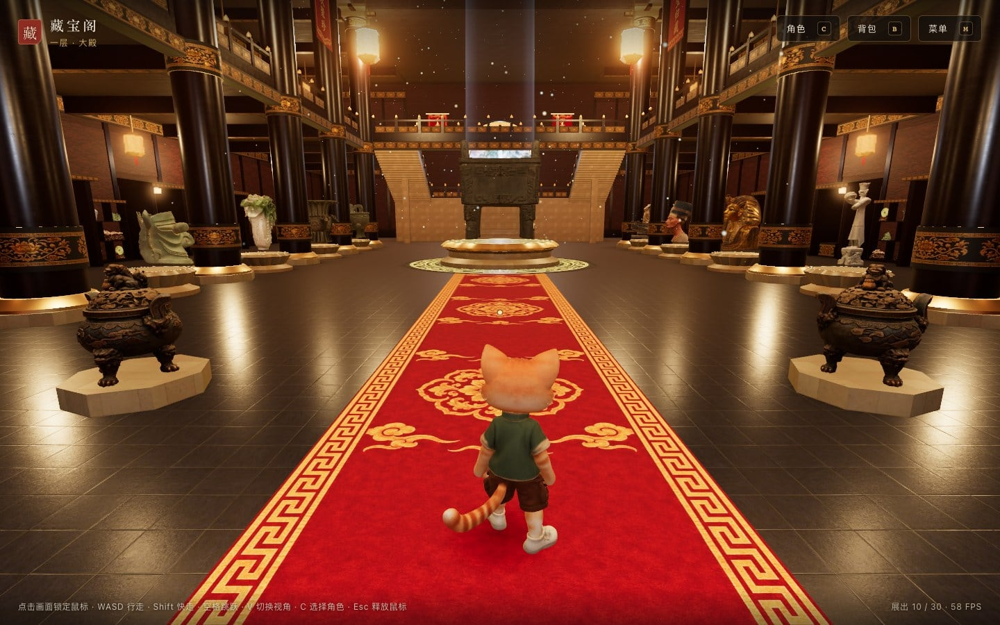
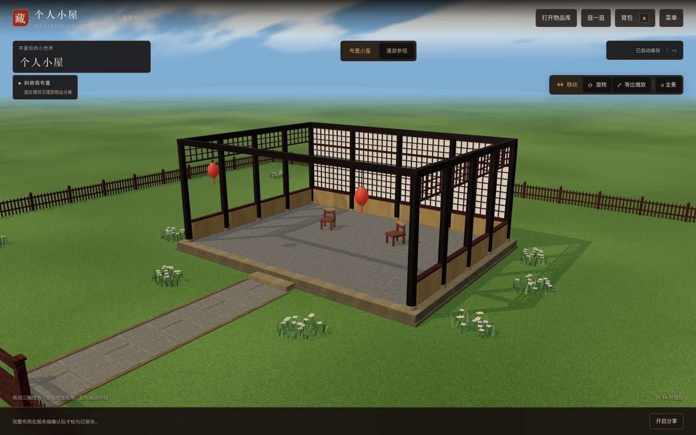

# 藏宝阁与个人小屋

**上传一张照片，AI 把它变成 3D 模型，摆进你自己的古风小屋，再发链接给朋友参观。**

这是一个在浏览器里玩的 3D 网站，不用装任何软件：

- **藏宝阁**：一座可以走进去逛的二层古建筑，30 个展台陈列古玩、文物方向的 3D 藏品。用键盘行走、跳跃，走近展台按 E 看藏品介绍。
- **AI 生成模型**：上传一张物品照片，调用 [Lux3D](https://labs.aholo3d.cn/api-docs/) 图生 3D 服务生成模型，自动收进你的「背包」。
- **个人小屋**：带庭院的古风小屋，把背包里的模型和官方家具摆进去，拖拽移动、旋转、缩放，自动保存。
- **分享与投稿**：小屋可以生成分享链接，别人不用登录就能进来参观、点赞；喜欢的藏品可以投稿，管理员审核后放进藏宝阁展出。

👉 **在线体验：[https://yafeng.fun](https://yafeng.fun)**（电脑 Chrome 浏览器体验最好）





## 技术栈

| 部分 | 用到的技术 |
|---|---|
| 网页前端 `apps/web` | React 19、Three.js、Vite |
| 后端接口 `apps/api` | Node.js 24、Fastify、PostgreSQL 18 |
| 后台任务 `apps/worker` | 调用 Lux3D 生成模型；用无头 Chrome 检查模型能否正常显示 |
| 共用代码 `packages/` | `contracts`（前后端共用的数据格式和场景几何）、`domain`（业务逻辑） |
| 3D 场景 | Blender 脚本建模（`scripts/blender/`），导出 GLB 后压缩给网页加载 |

## 运行前需要准备

目前只在 **macOS** 上开发和验证过。

| 需要 | 说明 |
|---|---|
| [Node.js](https://nodejs.org/) **24.x** | 必须是 24 版本（`package.json` 里限定了 `>=24 <25`） |
| [PostgreSQL](https://www.postgresql.org/) **18** | 推荐装 [Postgres.app](https://postgresapp.com/downloads.html)，放在 `~/Applications/Postgres.app`；装在别处就设置环境变量 `PG_BIN` 指向 PG18 的 `bin` 目录 |
| [Google Chrome](https://www.google.com/chrome/) | 浏览网页用；后台也要用它检查生成的模型 |
| Lux3D API key（可选） | 只有「上传照片生成模型」需要。没有 key 也能逛藏宝阁、布置小屋 |

## 快速开始

```bash
git clone https://github.com/songyafeng0324/lux3d-demo.git
cd lux3d-demo
npm ci                 # 安装依赖
npm run local:setup    # 建本地数据库、生成私有配置 .env、导入官方家具
npm run dev            # 同时启动网页、接口和后台任务
```

然后用浏览器打开 **http://localhost:5173** ，就进入藏宝阁了。

- `local:setup` 只需要第一次运行。它会在 `~/Library/Application Support/aholo-lux3d/` 建一个独立的数据库（端口 55432，不影响你电脑上已有的 PostgreSQL），并在项目根目录生成 `.env`（已被 git 忽略，不要提交）。
- 以后每次开发：先 `npm run db:start` 启动数据库，再 `npm run dev`。停止数据库用 `npm run db:stop`。
- 网页提示服务不可用时，打开 http://localhost:5173/api/v1/health/ready 看哪一项没准备好（数据库、存储、后台任务）。

### 开启 AI 生成（可选）

1. 申请 Lux3D 中国区 API key（[开放平台文档](https://labs.aholo3d.cn/api-docs/)）。
2. 打开项目根目录的 `.env`，填上 `LUX3D_CN_API_KEY=你的key`。
3. 重启 `npm run dev`。网页里「背包 → 生成任务」就可以上传照片了（PNG / JPEG / WebP，最大 10 MB），每个账号每天默认 10 次。

### 创建管理员（可选）

管理后台在 http://localhost:5173/admin ，用来审核投稿、安排展位、上传官方模型。网站没有默认管理员，要在终端创建：

```bash
npm run seed:admin
```

## 怎么玩

| 按键 | 作用 |
|---|---|
| 点击画面 | 锁定鼠标，开始行走 |
| `W` `A` `S` `D` | 移动 |
| `Shift` / 空格 | 快走 / 跳跃 |
| `E` | 查看面前展台上的藏品 |
| `V` | 切换第一人称 / 第三人称 |
| `C` | 选择角色 |
| `B` | 打开背包 |
| `M` / `Esc` | 打开菜单 / 关闭弹窗或释放鼠标 |

从右上角菜单进入「个人小屋」。注册、登录在菜单的「账号设置」里。

## 常用命令

| 命令 | 作用 |
|---|---|
| `npm run dev` | 开发模式启动（网页 5173，接口 3001） |
| `npm run build` | 打包全部子项目 |
| `npm start` + `npm run worker` | 打包后以正式方式运行接口和后台任务 |
| `npm test` | 单元测试（不调用 Lux3D，不写数据库） |
| `npm run test:integration` | 数据库集成测试（自动建临时库，结束后清理） |
| `npm run test:t10` / `test:t15` / `test:t08` | 浏览器回归：藏宝阁行走、第三人称、投稿展陈 |
| `npm run backup` | 备份数据库和模型文件 |

## 目录结构

```text
apps/web        网页前端（藏宝阁、小屋、背包、管理后台）
apps/api        HTTP 接口
apps/worker     后台任务：生成模型、检查模型、生成网页副本
packages/       前后端共用的数据格式与业务逻辑
migrations/     数据库迁移
assets/         藏宝阁建筑、贴图、家具、角色等 3D 资源
scripts/        本地数据库、建模、压缩、部署、验证等脚本
tests/          单元测试与集成测试
docs/           产品需求、技术方案、接口契约、验证记录、项目报告书
flow/           开发过程记录（计划、进展、决策、踩坑）
```

想深入了解的话：

- 更详细的本地运行说明（备份恢复、各项验证）：[docs/本地运行.md](docs/本地运行.md)
- 产品需求：[PRD v2.0](docs/product/藏宝阁与个人小屋-MVP-PRD-v2.0.md)
- 技术方案与数据接口：[MVP 技术方案](docs/architecture/MVP技术方案.md)、[数据与接口契约](docs/contracts/数据与接口契约.md)
- 部署到服务器：[部署说明](docs/部署说明.md)
- 全部文档索引：[docs/README.md](docs/README.md)
- 项目报告书（参赛提交）：[docs/report/](docs/report/)

## 许可证与素材说明

- 代码以 [MIT 许可证](LICENSE) 开源。
- `.env`、数据库与各种凭证都不在仓库里，`npm run local:setup` 会在你的电脑上生成一份私有配置。
- 第三方素材：`assets/t16/textures/polyhaven/` 是 [Poly Haven](https://polyhaven.com/) 的 CC0 贴图；Lux3D 生成的模型与 `assets/characters/` 下的角色形象（含动漫形象）不属于 MIT 授权范围，版权归各自权利人所有，仅用于参赛演示与学习。权利人如有异议，请通过 Issue 联系，将及时移除。
- 六个角色的离线预览页（`assets/characters/six-character-preview/`，225 MB）没有放进仓库，各角色的 GLB 已在 `assets/characters/<id>/`。

本项目为黑客松参赛作品，仓库作为开源交代保留，不保证后续维护。
