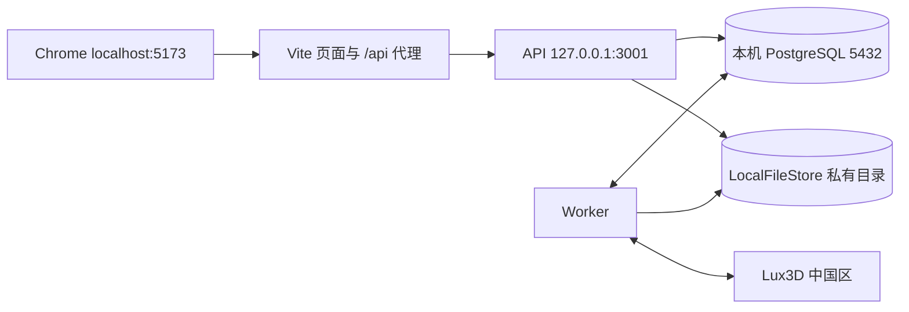

# T02 · MVP 技术方案（本地优先 v0.1）

日期：2026-11-04。状态：实施基线草案；T03/T04 验证结果须回填，未宣称软件已运行。
T05实施增量：基础工程已运行，本机PG实际为18.6/55432；命令已落地，版本与运行结果以 `docs/validation/本地基础工程验证.md` 为准。下文保留T02设计推导；真实生成及业务功能尚待验证。
依据：PRD、11-03/11-04 产品补充、T01。全部功能保留。数据和接口以 [契约](../contracts/数据与接口契约.md) 为准，测试以 [验收计划](../validation/MVP验收计划.md) 为准。

## 1. 实现选择及依据

采用 npm workspaces + TypeScript，React/Vite 网页、Three.js 原生场景模块、Fastify API、独立 Node worker、PostgreSQL 18、LocalFileStore。前台与后台同一 Web 应用；领域服务由 API/worker 共用。使用 pg 和参数化 SQL、版本化 SQL 迁移，减少 ORM 与数据库锁语义之间的隐含转换。首轮不引入 Redis、微服务或 Docker 依赖。

2026-11-04 只读检查：本机 arm64、macOS 26.6.2、Node 24.16.0、npm 可用；PATH 中未找到 psql/docker/brew（并不证明系统所有目录都没有这些软件）。本轮未安装依赖、初始化数据库或启动应用。

版本初始候选由 npm 官方 registry 当日读取；T05 安装时使用精确版本和 package-lock.json，验证工具链后锁定，不使用浮动 latest：

| 用途 | 版本候选 |
|---|---|
| Node | 24.16.0（当前本机） |
| React / react-dom | 19.3.1 |
| Vite / Three.js | 8.3.5 / 0.187.0 |
| Fastify / pg | 5.12.8 / 8.23.1 |
| TypeScript / Zod | 7.0.2 / 4.6.7 |
| Vitest / Playwright Test | 5.1.0 / 1.64.1 |
| PostgreSQL | 18 系列；安装时记录实际补丁版本 |

这些是已查询的发布版本，不是已通过集成的组合；若 T05 遇兼容问题，调整并记录版本及原因。Zod 校验共用领域输入；Fastify 路由使用显式 JSON schema/输出白名单，不假定 Zod 自动接入 Fastify。

## 2. 本地拓扑与运行合同

本地默认统一使用 `http://localhost:5173`，API 仅绑定回环地址；Web 代理 `/api`，保持 cookie 同源。打包运行时 API 可同时提供 dist 页面，使入口为 localhost:3001。局域网试用需要显式设置 HOST/PUBLIC_ORIGIN、同源入口和可达地址，分享仍免登录；不自动改路由器或开公网隧道。

数据库优先通过 Postgres.app 的 PostgreSQL 18 构建配置，无需为了本项目安装 Docker；若用户已有有效 PostgreSQL，直接复用独立数据库。使用项目数据库 `aholo_lux3d` 和受限应用角色，不使用生产数据；T05 负责实际探测和准备，当前尚未安装。[Postgres.app 官方说明](https://postgresapp.com/)。

本地持久目录默认 `~/Library/Application Support/aholo-lux3d/data/`：`objects/`、`staging/`、`backups/`。运行日志在相邻 `logs/`。数据不放 Vite public、不在 Git 内，也不使用临时目录承担持久化。DB 保存 object_key 与 hash，绝对本机路径不进入 API 返回值。

Storage 接口固定为 putStaged、commit、openRead、stat、delete；开发使用 LocalFileStore。对象 key 由服务端产生，禁止路径穿越和跟随越界软链；文件通过授权 API 流式读取，不直接挂静态目录。以后换对象存储只换 adapter，不把云 URL 写入领域对象。

拟由 T05 提供以下命令，当前尚不可执行：`npm ci`、`npm run db:migrate`、`npm run seed:admin`、`npm run dev`（管理 web/api/worker 子进程）、`npm run build`、`npm start`、`npm run worker`、`npm test`、`npm run test:e2e`、`npm run backup`、`npm run restore:check`。退出开发入口应停止子进程；关闭浏览器不停止 worker。Mac 睡眠/关机时不承诺后台继续，本机唤醒后恢复原任务。

配置：DATABASE_URL、DATA_DIR、PUBLIC_ORIGIN、API_HOST/PORT、SESSION_SECRET、LUX3D_REGION=cn、LUX3D_CN_API_KEY、PROVIDER_POLICY_PATH。样例仅包含占位值；API key 只在 API/worker 进程可读配置中使用，不进入 VITE_*。无 key 时健康页说明真实生成未就绪，既有本地资产和房间仍可操作；不能返回模拟生成成功。

## 3. 模块归属

| 模块 | 职责 | 禁止跨越 |
|---|---|---|
| apps/web | React 页面、独立后台路由、Three 场景、保存队列与反馈 | 不以按钮隐藏替代权限；不访问私有磁盘或持有供应商密钥 |
| apps/api | 身份、资源权限、业务事务、上传、快照、文件流 | 不在 HTTP 请求内等待长时间生成 |
| apps/worker | 供方调度/查询、落存、校验、清理、恢复 | 不绕过领域事务直接入包/扣次 |
| packages/domain | 业务服务、状态机、事务仓储、Storage/Provider ports | 不依赖 React 或插件缓存路径 |
| packages/contracts | schema、DTO、错误码、坐标与版本协议 | 不包含 DB 凭证或服务端密钥 |
| scripts 与 migrations | 环境探测、迁移、备份、种子和开发管理 | 不改变全局配置或无提示覆盖用户数据 |

后续创建模块时补局部 AGENTS/CLAUDE 入口；本轮不创建空工程。单一根级 flow/docs 不分裂。

## 4. 生成、持久化与异常恢复

受理→dispatching→provider_running→ingesting→validating→succeeded；submission_unknown 为待对账分支；确定未交付后 failed。用户只看生成中/成功/失败。

本地图片无法被供应商从 localhost 获取。Provider adapter 首选通过中国区 Asset API 上传本地文件取得供方可读引用，该能力须由 T03 核实上传、有效期、鉴权与生成引用方式。不要为此预设公共云桶。供应商引用和输出 URL 是临时工作数据，本站以已持久化文件为准。

每次 create 只发送一次；dispatching 崩溃不能按普通租约超时重新 create。保存 attempt 和供方 ID，用原 ID 恢复查询；未知结果先对账。T03 验证可关联查询/幂等能力后锁定算法。没有可靠关联能力时不假装解决 exactly-once。

队列使用 PostgreSQL jobs，短事务 `FOR UPDATE SKIP LOCKED` 领取，租约 token/fence 每次回写校验；外部调用不占长事务。普通查询/下载可有限重试，create 未知不可重试。全局供应商调度与单用户在途限制分开；在途容量计入未知供方调用，不因本站已结束而忽略。

文件先写 staging、校验摘要、同盘原子改名到稳定对象 key；然后在数据库事务中创建 ready asset、关联文件、标任务成功。重启后重做本地阶段不重生模型。固定渲染探针验证 GLB/纹理/包围盒，再做实际 Chrome 抽样；失败不暴露可用资产。DB 提交失败留下的孤儿由宽限期清理，不能删除仍被事务提交引用的文件。

任务恢复预算、最长交付等待、对账能力和供方参数属于 T03 待验证策略。定稿前真实生成出口保持有条件；实施不得无限“生成中”。策略终结失败时原日返还一次；迟到结果只做对账和清理，不复活任务。已成功任务的风险删除不返次数。

## 5. 编辑与可预览资产

内部 GLB 采用米、Y-up 右手坐标；每资产保留不可变 normalization（源中心/基础比例）和规范化 AABB，源文件不原地改。Placement 保存 position[3]、quaternion[4]、正数 uniformScale，默认 scale=1；同一资产各摆放独立 ID。

屋内范围由固定场景版本的可用体积定义；首版用封闭长方体可用区；T04已验证courtyard-v1与共享scene.ts数值，见场景方案。服务端/客户端以旋转缩放后的规范化 AABB 八角点全部在体积内判定；这是偏保守规则，必须用样本核对可用性，不允许只检查原点。允许重叠、叠放和悬空；无物理碰撞。若古建采用非矩形区域，在 T04 更新同一边界算法与版本，不能前后端各自猜测。

编辑拖动在本地更新，结束后进入串行防抖自动保存；保存反馈分未保存/保存中/已保存/失败或冲突。成功回执只确认所含操作序列；旧响应不能让新编辑显示已保存。数据协议为整房间版本替换，超大 payload 可分 staging chunks 后一次 commit，不引入件数上限或截断。不得启用未实现的分块端点；T04 若证明需用再补合同。

Three 输入分参观/编辑/详情模式；编辑控件只作用物品，相机互斥。第一人称 WASD/箭头、鼠标环顾、Esc 释放；按 E 的目标按距离、视线和稳定排序选一个；详情打开禁用走动。俯视/斜俯视编辑；独立模型预览用旋转缩放。没有数值输入、撤销重做或分享页物品详情。

GLB 的外链依赖必须在入库时解析并内化；首版自上传采用自包含 GLB，其他格式明确提示不支持。支持扩展、输入体积、纹理资源及面数策略在 T03 样本后定稿，不把旧稿数值当用户指定限制。[Three GLTFLoader](https://threejs.org/docs/pages/GLTFLoader.html)。

## 6. 身份、迁移与备份

账号密码使用 Node 异步 scrypt、随机盐和可升级参数，参数及 maxmem 在 T05 压测后固定，哈希中记录版本；使用 timingSafeEqual 比较。[Node Crypto](https://nodejs.org/api/crypto.html)。session 使用随机 256-bit opaque token，DB 存摘要；HttpOnly、SameSite=Lax，本地 HTTP 下 Secure=false，HTTPS 环境必须启用 Secure。写接口验证 Origin/CSRF；token 不放 localStorage 或 URL。

注册只生成普通角色，管理员通过独立 seed 命令交互创建，不硬编码密码；此命令不提供普通用户改密或重置接口。改密校验原密码，递增 credential_version 并撤销所有旧 session，客户端转登录。

迁移版本表+校验和+事务锁，失败回滚；seed 30 展位幂等、官方家具在上传校验后才可用。空数据库可运行 schema，不能写一批伪造成功任务假装验收。

备份先暂停新写入/worker 调度，维护锁覆盖事务与网络create，生成 DB dump 和同一已提交文件集合的 manifest/hash；数据库与目录一起恢复到隔离测试库/目录后核对。未知 create 的尝试记录不能回滚后再次派发：恢复环境默认关闭真实提交，只有完成包括备份之后新提交在内的完整对账才可解锁，详见下方补充约束。绝不覆盖用户现有库作为验证手段。

### 接入与恢复的补充约束

中国区 Asset API 上传是 T03 待核实的首选路径，不是已确认可用能力。确定的是供应商不能读取本机localhost；若该API不可用，须先找到并验证可用上传途径再解锁真实生成，不能假设有公共云桶。

失租worker迟到收到供方ID时向provider_evidence幂等追加匹配attempt/dispatch_nonce的证据，当前持租者核验后关联；fence限制业务写入，不能导致对账证据丢失。

维护锁必须覆盖所有活跃写入及跨网络create：先禁止新调度，等待在途create返回或持久化unknown，再取得独占维护锁生成备份。恢复环境默认永久关闭create，直到对照当前原环境日志/attempt及供应商历史，核对包括备份时点之后可能发生的所有提交；只核对备份内部attempt不足以解锁。无法完整对账时保持create禁用并记录阻断，原已确认任务查询/落存可单独恢复。APP_DATA_KEY持久配置用于稳定分享token加密，备份恢复须保持一致。

## 7. 实施出口与待验证项

| 项目 | 本轮设计结果 | 关闭条件 / 责任 |
|---|---|---|
| E01 | 自包含 GLB、Storage/Provider ports、上传与校验阶段明确 | T03 研发取得当前 API/真实样本、设输入策略 |
| E02 | 坐标、变换、边界算法与输入模式明确 | T04样本/共享几何已实测，T07复用 |
| E03 | 账本、队列、fence 与未知提交边界明确 | T03 研发/测试定稿终结/对账策略并故障验证 |
| E04 | 版本保存、回放、冲突与删除竞争明确 | T04隔离语义已测，T07/T08 PG事务与删除竞争仍待实测 |
| E05 | session、权限、改密与输入合同明确 | T05/账号实施测试；输入工程初值见合同 |
| E06 | 主机/浏览器/10 会话测量计划明确 | T04本机短测完成，T09高DPR/不同模型/长时回归 |
| E07 | 本地 PG+文件目录、命令、备份路径明确 | T05 基础工程实际运行与恢复，T03 接口可达 |

建议实施任务：T05 本地基础工程→T06 账号/资产/真实生成闭环→T07 小屋保存/分享→T08 投稿/后台/展位/删除→T09 完整集成验收。T03/T04 在相应模块前供给验证结果；完整业务开发授权与任务状态见 flow/plan。T02 是设计完成，T03/T04 完成前不能把全套参数标为冻结。
