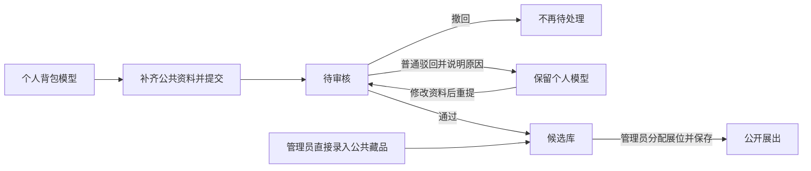

# 藏宝阁与个人小屋｜MVP PRD

## 1. 文档信息与使用约定

| 项目 | 内容 |
|---|---|
| 版本 | v2.0 · 2026-11-03 |
| 状态 | 业务访谈已收束；开发评审稿，待第二人复核及工程约束落实 |
| 产品 | 藏宝阁与个人小屋，名称暂定 |
| 交付范围 | 用户前台、管理后台、服务端、数据库、模型/图片持久保存及异步生成链路 |
| 需求提出人 | 本次对话用户，具名信息未提供 |
| 产品、设计、研发、测试及复核负责人 | 待指定，不虚构人员或日期 |
| 来源 | `访谈/` 中 S01、S02、S04～S11 的三张卡及场景 PRD；S03 已撤销 |
| 时间口径 | 北京时间（UTC+8）每天 00:00 换日，用于额度重置、临时调额及提交日归属 |

**本文件是汇总后的当前产品基线，替代 v1.x 及场景草稿中与最新确认相冲突的表述。**场景三张卡保留原话与修订过程；其中的历史候选不等于当前需求。

文中“已确认”来自用户明确表达或接受的流程；“补全”是有依据的展开，需列入复核；“待落实”是工程、设计或交付资料缺口，不能当成已验证结论。文档检查不代表功能、Lux3D 接入或性能测试已经通过。

版本关系：v1.0 为初稿和首轮审核对象；v1.1 为访谈期间修订稿；本 v2.0 汇总全部有效场景，取消旧稿冲突规则及未经确认的技术数值。

## 2. 背景与问题

用户描述，没有本网站时，需要先寻找 AI 工具或软件生成 3D 模型，再自己开发网站来展示。寻找工具、生成模型和开发网站每一步都可能让普通人受阻。

本产品打通“上传一张图片 → 生成模型 → 进入个人背包 → 布置自己的房间 → 分享链接”。公共的藏宝阁专门展示古玩、文物方向藏品；个人小屋可陈列手办、游戏角色、日常小物件等个人兴趣模型。

> 来源原话：“我的网站用户直接上传图片，生成模型放入个人背包，然后可以自己编辑房间，以及分享链接。相当于打通了整个链路。”

> 待落实（来源资料）：这是规划中的新网站，没有提供旧流程耗时、用户流失率、历史事故或运营量。不编造改善比例、增长指标及真实案例。

## 3. MVP 目标与完成判断

| 目标 | 当前依据 | 本期完成判断 | 验证方式 |
|---|---|---|---|
| 降低生成入口门槛 | 原先需要自行找工具 | 只选单张图片即可发起，不必先写名称简介或选择参数 | 演示真实提交 |
| 交付可用个人模型 | 用户明确“只有个人资产里出现了这个模型，才算成功” | 模型实际进入个人背包且可预览 | 查看背包、预览和任务结果 |
| 完成个人陈列 | 用户要自定义古建筑小屋 | 可摆放官方家具和个人模型，自动保存布置 | 编辑并重新进入核对 |
| 完成分享 | 用户要通过链接让他人观看 | 开启后持链接免登录只读参观，关闭不能进入，重开原链接恢复 | 用未登录访客验证 |
| 完成公共展陈 | 用户投稿和管理员录入共同供给 | 审核入候选、管理员分配展位、游客可参观及查看文物资料 | 从个人投稿到公开参观验证 |
| 完成后台供给及管理 | 用户要管理用户和全量资产 | 上传家具/公共藏品、审核申请、安排展位、查看用户及当天调额可使用 | 后台与前台交叉检查 |

生成成功不以外观满意或相似程度为门槛。已交付且可预览但用户不满意时，原任务仍成功，可在额度允许时换新图片另行生成。

运营增长、平均生成时长、生成成功率及写实效果不设无来源目标；功能完成也不代表这些指标已达到特定数值。

## 4. 用户、术语与权限

### 4.1 角色

| 角色 | 能做什么 |
|---|---|
| 游客 | 电脑端参观公共藏宝阁；通过有效链接只读参观个人小屋 |
| 注册用户 | 使用本人账号生成、查看背包、维护名称简介、布置本人房间、开关分享、提交及撤回待审申请、查看结果、维护本人昵称和密码 |
| 管理员 | 系统预置；录入和维护自录资产、审核申请、安排公共展位、查看用户及任务/资产、临时调额、直接删除风险模型 |

用户名是登录账号；昵称用于公开署名，用户可修改。普通自助注册不能取得管理员权限。管理权限不包括代改用户资料或编辑用户小屋，也不包括密码重置或账号停用/恢复。

### 4.2 业务对象

| 名称 | 含义 |
|---|---|
| 个人背包 | 用户已获得的个人模型及其名称、简介；模型不必已放入房间 |
| 官方家具 | 管理员录入、所有用户可复用的基础布置资产 |
| 摆放 | 某源模型在某房间内的一次使用，具有独立位置、方向和大小；同一模型可摆多份 |
| 投稿申请 | 用户主动把个人模型及本次公共资料交给管理员审核 |
| 候选藏品 | 管理员直接录入或用户申请审核通过、可供选择展出的公共藏品 |
| 展位 | 藏宝阁固定陈列位置；共 30 个，每位最多一个候选，同一候选最多占一个展位 |
| 当日已用 | 当日受理扣次扣除最终失败冲销后的净占用；包括尚未结束任务已占用的次数 |

审核通过、进入候选和占用展位是不同阶段。房间移除摆放、公共撤展和删除模型也是不同操作。

## 5. 范围与非目标

前台主要体验为藏宝阁和个人小屋，登录、背包、任务、详情及设置作为辅助入口，不预先锁定路由、侧栏或页面拆分方式。后台覆盖资产录入、投稿审核、展位和用户管理。

本期包含所有有效场景 S01、S02、S04～S11；P0/P1 原先用于安排访谈顺序，P1 不表示可以从 MVP 中省略。

**本期不纳入：**

- 手机 3D 操作验收；手机显示请使用电脑的提示。
- 模型下载；用户选择生成版本和参数。
- 房间撤销/重做、可编辑数值输入、物理碰撞模拟；不设 50 件或其他固定摆放件数上限。
- 分享小屋的物品详情和独立模型预览、未摆放背包展示、访客编辑、布置实时同步。
- 模型或账号停用/恢复、不可用占位；风险模型直接删除。
- 密码找回、管理员重置密码、临时密码交付；头像、手机号、邮箱和第三方登录。
- 后台图片生成入口、原记录替换模型文件、独立人工修复生成任务平台。
- 用户管理中的代改用户资料、代编辑房间，以及持续覆盖以后每日额度的设置。

未要求的付费、交易或积分货币系统不属于本期；对话中的“积分”仅表示生成次数。

## 6. 功能清单与来源

| 编号 | 功能 | 来源 | 为什么做 | 验证位置 |
|---|---|---|---|---|
| F01 | 注册登录、昵称、自行改密 | S09 | 区分本人内容及公开身份 | AC01～06 |
| F02 | 单图异步生成及任务列表 | S01 | 打通生成入口并允许离开等待 | AC07～11 |
| F03 | 日额度、单用户任务限制、失败返还 | S01、S11 | 限定使用次数且未交付不消耗 | AC12～15、47～49 |
| F04 | 个人背包与名称简介 | S01 | 保存可用模型并便于整理 | AC10、16 |
| F05 | 房间布置、列表、名称、自动保存 | S02 | 陈列官方和个人模型 | AC17～26 |
| F06 | 投稿、撤回、驳回重提 | S04、S07 | 用户主动推荐古玩文物模型 | AC27～30 |
| F07 | 人工审核及候选入库 | S05、S07、S09 | 维护公共展陈方向与提交资料 | AC31～33 |
| F08 | 30 展位分配、替换及撤下 | S06 | 从候选中选择公开陈列 | AC34～36 |
| F09 | 藏宝阁走动、按 E 详情与文物资料 | S07 | 让公众观看并了解藏品 | AC37～38 |
| F10 | 小屋链接只读分享 | S08、S09 | 分享个人布置成果 | AC39～42 |
| F11 | 上传现成家具/公共藏品及维护自录资料 | S10 | 提供官方布置与策展资产 | AC43～46 |
| F12 | 查看用户及仅当天调额 | S11 | 提供已确认的后台用户管理范围 | AC47～50 |
| F13 | 直接删除风险模型并清理引用 | 用户删除指令、S02/S04/S06 联动 | 执行用户指定的模型处理方式 | AC51 |

表中功能均已纳入 MVP，不人为把已确认功能降为可选。具体实现顺序由研发依赖确定，本文不排期。

## 7. 功能详述与规则

### 7.1 账号与公开身份

- 注册提供用户名、昵称、密码和确认密码；用用户名与密码登录，管理员由系统预置。
- 用户可修改本人昵称，不改变账号、资产或房间归属。不新增用户名修改能力。
- 已登录用户输入原密码、新密码、确认新密码；原密码正确且新密码确认一致时修改，成功后重新登录。
- 原密码错误或确认不一致时不修改；本期没有忘记密码找回或任何管理员重置流程。
- 藏宝阁用户投稿来源显示提交时的昵称，管理员录入显示“官方馆藏”；个人后改昵称不直接覆盖已提交的公共资料。分享小屋展示主人当前昵称。
- 用户名冲突不能覆盖原账号。昵称不替代账号身份；长度、字符与具体校验由工程/设计落实。

### 7.2 单图生成与任务

触发：注册用户有可用次数且没有未结束任务，选择一张图片提交。

1. 不要求生成前填写名称、简介或文物资料，生成版本和参数由系统统一配置。
2. 网站受理任务时先占用 1 次，当时尚未交付模型不等于失败。
3. 使用中国区 Lux3D 异步处理；用户可切页面、布置房间或关闭网页。
4. 用户任务列表显示本人任务的生成中、成功或失败消息。模型已生成但暂未存入背包时可继续保存处理，不提前报本站成功。
5. 模型实际进入个人背包且可正常预览，才标成功并保留扣次；最终未交付则标失败并返还本次次数。
6. 生成入包默认名采用“资产01”样式。用户之后可改名称、简介，不必为改文字重新生成。

**只有第三方成功状态、返回链接或一条任务记录，都不满足本站成功条件。**恢复、重试及超时判定由工程实现，不能让任务因网页关闭而丢失，也不能将同一任务反复当作新调用。

### 7.3 次数、调额与跨日

| 条件 | 结果 |
|---|---|
| 北京时间每天 00:00 | 默认重置为 3 次，前日未用不累计，昨日临时调额到期 |
| 网站受理新任务 | 占用当日 1 次；同一用户最多 1 个未结束任务 |
| 交付可预览背包模型 | 本次成功，保留占用 |
| 最终未交付 | 冲销该任务原提交日的本次占用，不重复返还 |
| 昨日任务今日才失败 | 不给今日额外增加次数；今日未使用且未调额时仍为 3 次 |
| 额度不足或已有未结束任务 | 不接受新的有效任务，不额外扣次 |
| 管理员调整当天总额度 | 不清空已用、不取消在途任务，只改变之后的新提交资格 |
| 新额度低于已用 | 暂不能新增任务，原任务继续，失败返还仍按真实记录处理 |

形式化口径：当日可用次数为当天有效总额度减去当日净已用，低于零时按无可用次数处理。此表达只展开已确认的调额与返还规则，不新增充值余额。

调额仅当天有效；没有持续覆盖以后每日额度的设置。失败返还后的有效次数可用于后续提交，但仍受单用户一个未结束任务限制。跨日未结束任务也占用该并发名额。

### 7.4 个人背包及小屋编辑

每位用户一间固定古建筑风格小屋，初始为空；固定建筑与用户摆放的物品分别处理。当前没有素材，由开发先做有中国古建筑特征的固定场景与基础桌椅柜，以流程可用为目标。

- 小屋浏览可走动；编辑时切换俯视或斜俯视。
- 从官方家具或本人背包添加物品，同一个官方或个人模型可重复摆放，每次摆放独立。
- 鼠标完成选中、XYZ 移动、XYZ 旋转和等比缩放；第一版没有可编辑数值输入、撤销/重做。
- 可重叠、叠放及悬空，但不能摆出房屋可用边界；不做物理碰撞模拟。
- 提供房间物品列表，可选择、定位和移除被遮挡的摆放。
- 从房间移除只撤下该次摆放，背包原模型及其他副本保留。
- 用户可改房间名称，修改采用自动保存；不设置物品件数上限，不静默截断布局。

> 补全 B01：自动保存成功后重新访问应恢复该布局和物品变换。依据是用户要求保存布置、选择自动保存，且 S08 确认访客可读取最新成功保存的房间。本项为保存要求的可观察展开，保留供第二人复核。

保存反馈、尚未保存完成时离开、保存失败保护及多页面同时编辑由工程/设计落实；“自动保存”不表示可以把未保存成功的编辑提示为已保存。

### 7.5 公共藏品资料

以下资料用于用户投稿、管理员公共藏品录入、后台审核及公开详情；普通个人背包和官方家具不必填写整套文物资料。

| 资料 | 要求和含义 |
|---|---|
| 名称 | 使用对应公共名称；个人生成后可维护名称 |
| 简介 | 必填 |
| 年代 | 必填，不清楚允许“不详” |
| 材质 | 必填，不清楚允许“不详” |
| 归属类型 | 必填，“个人收藏/博物馆” |
| 收藏方名称 | 必填，具体收藏者名称或博物馆名称 |
| 地点 | 必填，当前收藏所在地，城市/地区即可，不要求具体地址 |
| 官网 | 选填，对应收藏方官方网站 |
| 来源署名 | 系统按投稿时昵称或“官方馆藏”展示，与实际收藏方分别记录 |
| 对应模型 | 申请或录入的 3D 模型，公共详情有独立旋转缩放预览 |

年代/材质为“不详”可以进入人工审核，是否通过仍由管理员判断；不等于自动通过。官网为空不阻止有效投稿、录入或展出，不增加证明材料或专业鉴定模块。

### 7.6 用户投稿、撤回及审核

1. 用户从自己的成功背包模型详情申请加入藏宝阁，无需先摆进房间。
2. 提交名称、简介及上述展览资料；必填资料为空不能有效提交，官网除外。
3. 申请进入待审核，管理员看到本次模型、原图、公共资料、申请人和提交时间；模型可旋转查看。待审默认最早提交优先。
4. 待审时用户可以撤回，已撤回申请不再作为有效待处理对象。
5. 管理员人工判断是否符合古玩文物方向，只通过或驳回，不代改申请资料。
6. 普通驳回要让用户看到原因；个人模型保留，可修改资料后用同一模型重新申请，无需重新生成。
7. 通过进入候选库，不自动展出。审核使用本次提交信息，后续个人资产或昵称修改不直接覆盖公共资料。

审核与撤回、重复请求的处理须保持一致，不能出现同一申请既已撤回又有效入候选的结果；具体协调方式交工程落实，不增加审批层级或审核时限。

### 7.7 藏宝阁展位与参观

- 固定 30 个展位，候选库可超过 30 个；同一候选只占一个展位，每位最多一件，允许留空。
- 管理员选择、替换或撤下藏品，系统自动居中并适配大小；没有手动高度、旋转或缩放调整工具。
- 后台保存有效安排即发布，无额外发布步骤；替换/普通撤展只解除原展位分配，不删除个人模型，不改变私人小屋。
- 新进入或刷新读取最新普通展陈；已打开的参观页保持当前展陈，刷新或重新进入后更新。
- 游客无需登录，电脑浏览器第一人称参观。WASD 或方向键移动，鼠标环顾，Esc 释放鼠标，并提供回到入口操作。
- 靠近藏品出现按 E 打开详情的提示，按 E 查看对应详情，不采用点击藏品打开。
- 详情展示第 7.5 节公共资料和可旋转缩放的独立模型预览。空位不展示模型，未分配候选不自动展出。

场景视觉样本、展品可接近范围、多个展品的交互目标和详情开关控制由设计/研发落实，不擅自指定米数、视点高度或移动速度。

### 7.8 小屋分享

- 默认私有；所有者开启后获取链接，持链接者免登录只读参观。
- 分享页展示房间名称、主人当前昵称及实际摆放物品；不提供物品详情、按 E 详情提示、独立模型预览或未摆入房间的背包模型。
- 访客不能编辑、生成或访问整个私人背包；不提供模型下载入口。
- 关闭分享后不能通过链接进入；再次开启沿用原链接，原先拿到链接的人可以再次访问。
- 新进入、刷新或重新进入时读取最新成功自动保存的房间；已打开页面保持当前布置，不实时同步。

关闭后的访问校验、无效链接反馈及保存中/失败时的分享反馈交工程/设计落实，不新增手动保存步骤或主动换链接功能。

### 7.9 管理员上传与维护

- 后台只上传已经制作好的模型文件，图片生成走已有用户端流程，不增加后台生成任务。
- 上传选“官方家具”或“公共藏品”：家具成功后供所有用户布置，公共藏品直接进入候选库，不走用户投稿审核、不自动占展位，也不自动进入家具选项。
- 家具维护基础名称、简介等资料；公共藏品维护第 7.5 节资料，来源显示“官方馆藏”。
- 管理员可改自录资产名称、简介及公共展览资料，不原地替换模型文件。
- 换模型重新上传一条资产，旧摆放或展位不自动改为新模型，仍需通过已有布置/策展操作主动选择。
- 不支持格式、不能加载或保存失败的模型，不作为成功可用资产提供给用户或策展；支持范围与失败反馈由工程明确。

### 7.10 用户管理与风险删除

用户管理可查看用户名、昵称、注册时间、生成次数、任务及资产信息，调整其当天生成总额度；不代改用户资料、不编辑其小屋，不提供账号停用/恢复或密码重置。调额规则见第 7.3 节。

涉及版权或法律风险的模型由管理员直接删除，清理其在个人背包、小屋摆放、候选及公共展位的对应引用，其他模型及布局保留。不显示不可用占位，不提供恢复流程；普通主题不符的驳回和普通撤展不等同于风险删除。

## 8. 质量要求与工程待落实清单

| 编号 | 类别 | 已明确的结果或待落实内容 | 责任角色及落实时点 |
|---|---|---|---|
| E01 | 输入与模型处理 | 待落实：图片/模型输入格式、体积、复杂度、可加载检查、Lux3D 实际配置；旧稿 10 MiB、100 MiB、30000 面或 G1 不作为用户已选定参数 | 研发，接入及输入设计落实前 |
| E02 | 场景与编辑 | 待落实：古建视觉样本、基础家具具体样式、房屋可用边界、初始模型适配和交互细节；不自行设屋子米数、模型倍数或家具数量 | 设计/研发，相关场景设计落实前 |
| E03 | 生成与次数一致性 | 持续处理不依赖用户留在网页，成功与真实交付一致；待落实：任务恢复、结束判定、防重复、原提交日冲销及调额并发验证 | 研发/测试，生成链路实现及联调前 |
| E04 | 保存与失败反馈 | 不把失败保存提示为成功，不因件数截断布局；待落实：自动保存反馈、关闭前未完成保存、失败保护、多个页面修改及模型加载恢复 | 研发/设计/测试，编辑与展示实现前 |
| E05 | 账号与权限 | 本人数据、管理员和分享权限分别校验；待落实：用户名/密码/昵称校验、登录保持、改密后凭证失效、输入及错误反馈 | 研发/设计，账号与授权实现前 |
| E06 | 性能、兼容及可访问性 | 电脑端验收，手机提示；待落实：具体浏览器版本、参考电脑、模型/房间测试规模、加载/帧率/并发目标、服务可用性和可访问性要求 | 产品/研发/测试/设计，相关质量验证方案确定前 |
| E07 | 运行与诊断 | 需具备全栈、数据库及文件持久保存的运行环境；待落实：实际部署环境、Lux3D 中国区可用凭证、失败定位和运行维护方式 | 研发，环境准备及真实联调前 |

具名人员和具体日期均待团队指定；表中的时点是工作依赖，不是工期承诺。以上工程方案不能改变成功、返还、只读、快照、展示范围和当天调额等已确认产品规则。

不以“无限件数”承诺任意硬件可承载无限模型，也不能以性能方案为由新增未确认的产品件数上限。实际承载结果需测量并记录，不使用自拟的 100 个实例、帧率或秒数作为既定验收指标。

## 9. 验收标准

以下为待执行检查，**不是已经通过的测试记录**。每项都应记录实际数据、设备/浏览器、操作、结果及失败原因。原有场景 PRD 的更细检查可供测试展开；本表覆盖全站关键结果。

| 编号 | Given：前置 | When：操作/事件 | Then：可观察结果 |
|---|---|---|---|
| AC01 | 有未被占用的有效账号资料 | 注册后用用户名密码登录 | 普通身份可访问本人背包和小屋，不能自选管理员身份 |
| AC02 | 注册确认密码不一致或用户名已被占用 | 尝试注册 | 不完成有效注册，不覆盖已有账号 |
| AC03 | 用户已登录 | 修改昵称 | 昵称可修改，登录账号和资产归属不变 |
| AC04 | 原密码正确，新密码确认一致 | 自行改密 | 成功后重新登录，新密码可用，原密码失效 |
| AC05 | 原密码错误或新密码确认不一致 | 提交改密 | 不修改，原有效密码保留 |
| AC06 | 查看前台及用户管理后台 | 检查密码恢复操作 | 不提供找回、重置或临时密码交付 |
| AC07 | 有额度且无未结束任务 | 仅选一张有效图片提交 | 不要求名称简介或参数，受理占用 1 次 |
| AC08 | 任务已受理 | 离开或关闭网页后返回 | 原任务继续，可在本人任务列表查看进行中或最终结果 |
| AC09 | 供应商有结果但未交付可预览背包模型 | 任务最终结束 | 不标本站成功，失败冲销本次原提交日占用 |
| AC10 | 模型已进入个人背包且可预览 | 查看任务及次数 | 本站任务成功，本次占用保留 |
| AC11 | 模型已成功但用户不满意外观 | 在有额度、无未结束任务时换图提交 | 原任务仍成功，可发起新的生成 |
| AC12 | 昨日有未用次数或临时调额 | 到北京时间 00:00 | 默认新一天恢复 3 次，不累计旧余量或保留旧调额 |
| AC13 | 昨日任务今日失败，今日未使用也未调额 | 结算失败 | 今日仍为 3 次，不额外增加 |
| AC14 | 用户已有未结束任务，包括跨日任务 | 再提交 | 不突破同时 1 个任务限制，不新增扣次 |
| AC15 | 用户没有可用次数 | 再提交 | 不受理新任务，不额外扣次 |
| AC16 | 新模型已入背包 | 查看及编辑资料 | 默认名为“资产01”样式，名称简介可修改，不要求重新生成 |
| AC17 | 有官方家具和本人模型 | 分别重复添加同一来源模型 | 可形成独立摆放副本，不因源模型相同拒绝 |
| AC18 | 所有者已选中房间物品 | 鼠标移动 | XYZ 位置可调整，不要求数值输入 |
| AC19 | 所有者已选中房间物品 | 鼠标旋转 | XYZ 方向可调整，不要求角度输入 |
| AC20 | 所有者已选中房间物品 | 鼠标等比缩放 | 大小可调整，不要求倍数输入 |
| AC21 | 物品仍在房屋可用区域 | 重叠、叠放或悬空摆放 | 不因这三类陈列而拒绝有效布局 |
| AC22 | 物品接近房屋边界 | 尝试摆出可用区域 | 不形成有效越界布局 |
| AC23 | 房间物品被遮挡且有同模型副本 | 从物品列表选中、定位并移除一次摆放 | 操作对应那次摆放，其他副本及背包源模型保留 |
| AC24 | 布置修改已经自动保存成功 | 重新进入房间 | 恢复对应布局和变换；按 B01 复核及验证 |
| AC25 | 用户拥有小屋 | 修改房间名称 | 使用自定义名称，不被强制固定为默认标题 |
| AC26 | 已有多件可在屋内摆放的物品 | 继续添加并保存 | 不因固定件数门槛拒绝或静默截断；实际性能另按 E06 记录 |
| AC27 | 本人模型在背包，公共必填资料齐全，未摆入房间 | 提交申请 | 可进入待审，原图、模型及本次资料可供管理员查看 |
| AC28 | 公共必填资料为空 | 投稿或管理员录入公共藏品 | 提示补齐，不能作为有效完整资料；官网为空除外 |
| AC29 | 年代/材质为“不详”、官网为空且其余资料完整 | 提交申请 | 可进入人工审核，不因“不详”自动通过或拒绝 |
| AC30 | 本人申请仍待审核 | 撤回 | 不再有效待处理，不继续作为待审通过 |
| AC31 | 管理员普通驳回 | 用户查看结果并修改资料重提 | 原个人模型保留，原因可见，同一模型可重新申请 |
| AC32 | 多条待审申请有不同提交时间 | 管理员查看审核 | 默认最早提交优先，可查看提交资料和旋转模型，只通过或驳回、不代改 |
| AC33 | 管理员通过申请，用户随后改个人资料或昵称 | 查看候选、公共资料及展位 | 候选建立，不自动占展位；公共资料保留该次提交信息和昵称 |
| AC34 | 有超过 30 个候选，同一候选已有展位 | 管理员安排其他展位 | 固定 30 展位不增多，同一候选不同时占多个展位 |
| AC35 | 管理员给展位选择有效藏品，部分展位为空 | 保存安排 | 自动居中适配，可带空位发布，无手动高度/旋转/缩放编辑工具 |
| AC36 | 已有公共展位且个人房间使用同一模型 | 普通替换或撤下并保存 | 原展位关联解除，个人模型和私人摆放不被删除 |
| AC37 | 游客未登录、使用电脑浏览器 | 进入藏宝阁并靠近展品按 E | 可第一人称参观、出现按 E 提示并打开对应详情，有回到入口操作 |
| AC38 | 藏品已分配且公共资料完整 | 查看详情 | 展示文物资料、独立旋转缩放预览及投稿时昵称或“官方馆藏”，收藏方独立展示 |
| AC39 | 小屋默认私有或已关闭分享 | 其他人通过链接进入 | 不能进入该私人房间 |
| AC40 | 分享已开启 | 未登录访客参观 | 只读观看房间名称、主人当前昵称及已摆物品，无详情、独立预览或未摆放背包模型 |
| AC41 | 分享曾关闭，访客保留原链接 | 所有者重开后访问原链接 | 原链接恢复，不要求新链接 |
| AC42 | 访客已打开藏宝阁或分享小屋 | 管理员更新展陈或主人成功保存新布置 | 原页面保持当前普通场景；刷新或重进读取最新发布/成功保存状态 |
| AC43 | 管理员选择家具用途并成功上传现成模型 | 普通用户打开官方资产 | 所有用户可选该家具，不要求文物资料 |
| AC44 | 管理员选择公共藏品用途且资料完整 | 成功上传 | 直接进入候选库，不走用户投稿审核、不自动展出或进入家具选项 |
| AC45 | 管理员已有自录资产及旧模型引用 | 修改文字资料或另上传新模型 | 文字可维护，原文件不能原地替换；新模型是新资产，旧引用不自动切换 |
| AC46 | 文件不支持、不能加载或保存失败 | 尝试完成后台上传 | 不作为可用家具或可策展藏品；后台没有图片生成入口 |
| AC47 | 管理员已登录 | 查看用户并调整当天额度 | 可查看账号、昵称、注册时间、次数、任务及资产；不代改资料、编辑房间或停用账号 |
| AC48 | 当天已用 2 次 | 管理员把总额度调为 5 次或 1 次 | 前者剩 3 次；后者不能新增，已用不清零，原任务继续；这些仅为算例 |
| AC49 | 当天任务最终失败且有调额 | 结算失败 | 本次占用只冲销一次，按当前当日总额度和真实已用判断后续资格 |
| AC50 | 普通用户尝试调整他人额度、审核或修改他人布局 | 发起操作 | 不取得相应管理或编辑权限 |
| AC51 | 管理员确定某模型按风险删除规则处理 | 删除该模型 | 个人背包、对应房间摆放、候选和公共展位清理该模型引用，其他模型保留；无停用占位或恢复 |

AC48 中的 2、5、1 是沿用用户接受的调额算例，不是产品预置值、永久规则或上限。自动适配、古建视觉和无件数上限的实际体验还需结合 E02/E06 的素材及工程验证。

## 10. 异常与边界汇总

| 范围 | 正常路径对应的异常 | 已明确结果或工程归属 |
|---|---|---|
| 注册/登录/改密 | 重复账号、确认不一致、错误凭证或原密码 | 不完成错误操作，原账号/有效密码不被覆盖；反馈见 E05 |
| 生成 | 服务失败、模型未入包或不可预览 | 最终失败返还，不以第三方状态代替交付；暂时故障恢复见 E03 |
| 生成 | 额度不足、已有未结束任务、重复提交 | 不突破额度/并发，不重复扣次；并发检查见 E03 |
| 次数 | 午夜、跨日失败、调额与返还同时发生 | 北京时间日界、原日冲销、仅当天调额；一致性见 E03 |
| 编辑 | 越界、遮挡、误移除 | 越界不保存为有效布局；可用物品列表；没有撤销重做，按用户选择自行调回或重新摆放 |
| 保存 | 保存未完成、失败或多页面冲突 | 不伪报成功、不静默截断；编辑保护和反馈方案见 E04 |
| 投稿审核 | 必填缺失、已撤回、重复处理、普通驳回 | 缺资料补齐，已撤回不继续待审，驳回保留模型并返回原因可重提；一致性见 E03/E05 |
| 展位 | 重复占位、空位、保存失败 | 不重复占位，允许空位；未保存成功不宣称已发布 |
| 浏览/分享 | 模型加载失败、不支持渲染、无效或关闭链接 | 不视为成功参观；权限及提示/恢复见 E04～E06 |
| 后台上传 | 不支持文件、不可加载、保存失败或重复请求 | 失败不列为可用资产；检查与恢复见 E01/E04 |
| 用户管理 | 无权限、无效调额输入或提交失败 | 不越权、不伪报调额成功，不影响已受理任务 |
| 删除与撤展 | 风险删除与普通撤展混淆 | 风险直接删除引用；普通撤展保留模型及私人摆放，无停用/恢复分支 |

## 11. 依赖、复核与交付边界

### 11.1 开发依赖

- 中国区 Lux3D 实际可用的接入条件、配置及环境；本文不要求在聊天中填写密钥，也未进行真实生成联调。
- 可持久保存账号、任务、次数、资产、布局、投稿和展位关系的完整运行环境，具体架构由研发决定。
- 开发准备古建固定场景及基础家具，设计明确可用边界、展示适配和交互样本。
- 测试按本 PRD 和 E01～E07 落实真实模型、异常、跨日及权限验证，记录测量结果；模拟任务不能代替最终真实生成闭环。

### 11.2 已知缺口及复核

| 项目 | 当前状态 | 不得误读为 |
|---|---|---|
| 业务主链路及范围 | 有效场景访谈完成，规则已汇总 | 已经实现或已经通过运行验收 |
| E01～E07 | 工程/设计待落实，具名负责人及日期待指定 | 可以直接使用旧稿自拟阈值，或可省略工程检查 |
| B01 保存后恢复 | 有依据的补全，需复核并验证 | 用户逐字确认了保存异常的每个实现分支 |
| 历史量化及运营目标 | 未提供，不编造 | 已承诺增长、效率或生成质量指标 |
| 独立复核 | 待作者之外的第二人核对本稿及来源 | 本次 AI 格式检查构成产品正确性或技术可行性认证 |

本期完成需要跑通真实的生成入包、布置自动保存、链接分享、投稿审核与展位展出，以及管理员直接上传和当天调额，并保留对应验收记录。本文不指定排期，不把尚未执行的联调和性能检查写成通过。
