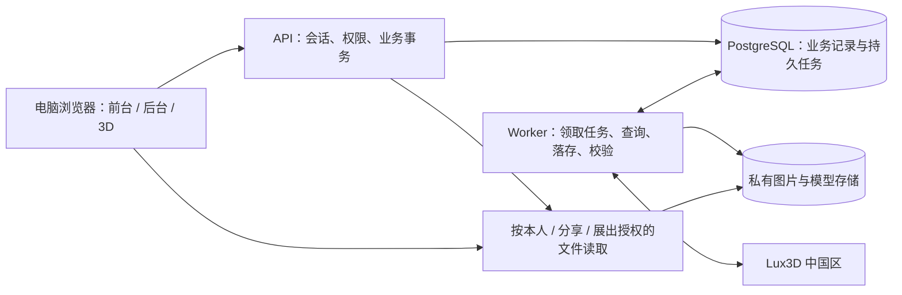

# T01 · 开发前评审

日期：2026-11-03（协作记录 Asia/Tokyo；产品日界仍为 Asia/Shanghai）。产出：Codex。状态：书面评审完成，有条件通过；工程验证待执行。

依据：[PRD v2.0](../product/藏宝阁与个人小屋-MVP-PRD-v2.0.md)、[本轮补充确认](../product/2026-11-03-需求补充确认.md)、项目宪章与 T01。建议、已确认规则和真实验证分开记录；本文不替代产品基线或接口契约。

## 1. 结论与推进条件

**有条件通过开发前书面评审，建议进入详细设计与关键链路验证。尚不具备“全部工程依赖已落实”或“可按期交付”的证据。**

F01～F13 的业务链路能够组成一致的 MVP，未发现必须删功能才能解决的直接逻辑矛盾。主要不确定性集中在供应商提交结果未知时的恢复、资产可预览判定、3D 编辑保存与性能；分享关闭/风险删除后的已开页行为已由用户确认。AC01～AC51 已逐项建立验证映射，均为待执行。

用户已确认 2026-11-16 服务器演示/试用目标和同模型投稿唯一规则。全部 MVP 功能保留；预算、云资源和开发投入未知；验收设备与 10 人在线场景已确认，不能从日期倒推出已足够的人力或并发能力。

当前可以进行：T02 详细方案、T03 接入验证准备、T04 场景与交互验证。依赖事项须在对应实现前闭合；不能只做页面后把真实生成、持久化、权限和并发验证推到交付当天。

## 2. 用户决定、已确认事项与工程默认建议

### 2.1 本轮已确认

| 编号 | 结论 | 本轮记录 |
|---|---|---|
| D01 | 服务器部署，供指定人员演示/试用 | 用户明确选择；不新增邀请系统，原有免登录参观仍成立 |
| D02 | 2026-11-16 为目标交付日 | 用户明确日期；资源和预算待定，不是工程承诺 |
| D03 | 同一模型最多一条待审或一个候选，撤回/驳回后可重提 | 已形成产品增量；已是候选但未展出/已撤展，也不能绕过约束再投稿 |
| D05 | 关闭分享/风险删除仅新进入或刷新时生效，旧页可继续显示已加载内容 | 用户选定；不做主动清屏、强制退出或定时推送移除。新增资源请求仍须按当前授权校验，不承诺撤销后继续下载未加载文件 |
| D06 | MacBook M5、32GB 内存、最新版 Chrome；10 人试用/最多 10 人同时在线 | 用户指定；测试时锁定实际系统及浏览器版本。生成并发、模型复杂度与性能目标仍由工程测量落实 |

### 2.2 仍需用户决定（建议已具体化）

| 编号 | 待决定事项 | 建议 | 替代选择及影响 | 最迟影响阶段 |
|---|---|---|---|---|
| D04 | 云资源与费用范围 | 一套支持常驻 API/worker 的服务器环境，PostgreSQL 与私有对象存储；优先复用已有资源。先给云环境/区域及可接受预算，再按真实配置报价 | 本机无法满足已选服务器交付；托管拆分服务减少机器维护但新增服务配置及成本比较 | T02 部署方案、T03 真实联调前 |
D04 是当前剩余的资源决策：选定已有/新购云资源及预算上限后，给出具体配置与报价；Lux3D 凭证可用性仍需在真实环境核验。用户此前对这些项回复“待定”，本轮不自行选择付费服务。

D05 现已确认不主动撤销已加载画面。新进入/刷新必须获得最新有效状态；已删除文件的服务端读取资格不因旧快照而恢复。已加载字节不尝试收回，不为本功能增加实时推送或周期失效机制。

生成验证的具体成本要等接口参数和真实报价，当前未报价、未生成。工程细节无需用户逐项挑选。

### 2.3 可由工程落实的建议

以下仍是建议方案，进入 T02 后形成正式合同：模型内部交付优先 GLB；用服务端 session 管理登录；布局使用版本号和条件写入；任务采用独立 worker 与持久状态；按源模型区分资产和每次摆放。无需为这些低层选项逐项增加业务审批，但不能把它们写成用户已选定的产品参数。

## 3. 推荐架构与边界

建议采用 TypeScript 单仓：React + Vite 网页、Three.js 场景、Node.js + Fastify API、独立 worker、PostgreSQL 和私有对象存储。前台与后台在同一 Web 工程内按权限和功能划分，业务模块保持清晰；API 与 worker 可共用领域代码，部署为独立进程。技术栈尚未锁版本或安装。

这是基于项目规模和依赖的工程选择：统一语言便于共享输入输出类型；worker 承担轮询、文件落存和校验，使网页关闭或 API 进程重启不丢任务。Vite 支持前端构建，Fastify 支持基于 schema 的校验与序列化；这些能力可作为实现基础，但不代表它们自动解决业务一致性。[Vite 官方指南](https://vite.dev/guide/)、[Fastify 官方文档](https://fastify.dev/docs/latest/Reference/Validation-and-Serialization/)。

候选模块目录为 `apps/web/`、`apps/api/`、`apps/worker/`、`packages/domain/`、`packages/contracts/`；本轮只描述，不建空代码目录。确定后每个独立应用补局部入口，继续共用根级 flow/docs。

### 3.1 持久任务与事务

MVP 建议先用 PostgreSQL 持久任务表，避免同时引入另一套队列基础设施。短事务领取任务、租约与心跳、到期恢复、尝试计数、下一次执行时间、工作进程 fencing token 共同控制执行；网络调用期间不持有数据库行锁。`SKIP LOCKED` 只用于领取队列项，不用于跳过用户额度检查。官方文档支持它用于多消费者队列场景，也明确它不是通用一致性查询方法。[PostgreSQL SELECT](https://www.postgresql.org/docs/current/sql-select.html)。

数据库约束兜底：单用户一个非终态任务、每任务唯一扣次/冲销事件、每任务至多一个成功资产、每候选最多一个展位、每展位最多一个候选、投稿有效状态按 D03 唯一。条件唯一索引可用于部分状态的唯一约束，具体 schema 和状态迁移在 T02 定稿。[PostgreSQL Partial Indexes](https://www.postgresql.org/docs/current/indexes-partial.html)。

仅有任务表不等于可靠队列：必须验证进程被杀、租约过期、旧 worker 恢复、事务提交前后崩溃；若团队已有成熟队列，可在 T02 比较替代，但业务幂等仍由数据库保证。

### 3.2 建议的数据边界

| 对象 | 必须独立保存的内容或边界 |
|---|---|
| User / Session | 身份、角色、密码哈希、会话版本；昵称是公开展示，不作身份键 |
| GenerationTask / Attempt | 本站任务 ID、提交日、参数快照、供应商任务 ID、状态、阶段、恢复证据；供应商大整数 ID 作为不丢精度的字符串传递 |
| QuotaDay / QuotaEvent | 用户+北京时间日期、当天调额、扣次与冲销事件；不做一个可被跨日覆盖的总余额 |
| Asset / AssetFile | 来源类型、归属、原图、模型与贴图文件、校验结果；文件先就绪后对用户可用 |
| Room / Placement | 一人一屋；布局版本、房间名；每次摆放独立 ID、源资产 ID、位置、旋转、等比缩放 |
| Submission / Candidate | 本次提交资料和昵称快照；批准生成候选；不读用户当前昵称覆盖公共署名 |
| ExhibitSlot / PublishedScene | 固定 30 展位；保存即原子发布版本；游客请求读取一致快照 |
| Share | 稳定随机链接标识+是否开启；关闭不换标识，重开恢复；文件授权也受分享状态约束 |
| DeletionEvent / FileCleanup | 只保留必要任务/审计和文件清理信息以防重复导入，不提供被删除模型的展示、停用或恢复功能 |

不按文件 hash 合并不同用户的逻辑资产。物理去重若以后引入，必须检查引用，避免删除一个源模型时删除别人的资产。资产删除不把已经成功的生成任务改成生成失败，也不返还已成功任务的次数。

## 4. 工程待落实项 E01～E07

以下每项均已给建议与验证路径，但没有运行证据的项目仍为“待落实”。负责人仅列角色，不虚构具名人员。

| 编号 | 建议方案 | 必须取得的证据 / 验收 | 负责角色与前置依赖 | 评审状态 / 去向 |
|---|---|---|---|---|
| E01 | 图片先保存；验证格式、真实内容和资源规模。模型优先统一到 GLB，原产物与贴图持久保存；后台优先接收可直接预览的 GLB，其他格式先明确转换策略。配置从服务端统一下发，不让用户选版本参数 | 当前中国区 schema、模型能力、实际报价、结果样本与 TTL；验证真实 GLB 的材质/贴图、包围盒和渲染；损坏/外链缺失/过大输入失败路径。体积、面数和扩展支持范围须量测后定稿 | 研发；供应商访问、文件存储、渲染器 | 待落实，T03；不沿用旧稿阈值或默认 G1 |
| E02 | 固定古建壳体与可编辑物品分离；源资产归一化变换与摆放变换分层；XYZ 移动/旋转、单一等比缩放；物品列表按摆放 ID 操作。用变换后的模型边界检查屋内可用区域，前后端规则相同 | 一份可操作古建样本、桌椅柜样本；旋转/缩放后越界、遮挡定位、重复摆放、入口与 E 交互测试；房屋和展位适配规则评审 | 设计/研发；坐标约定和真实模型包围盒 | 待落实，T04；不写死未经确认的尺寸或件数 |
| E03 | 任务持久化、唯一请求键、短事务扣次；worker 恢复；供方成功后落存+校验再入包。未知提交先对账，不能盲重发；冲销绑定原提交日且只执行一次 | 网络超时、创建成功但 ID 未落盘、进程重启、回调/查询重复、跨日、调额竞争和迟到结果测试；第三方幂等及对账能力验证 | 研发/测试；E01、数据库事务、供应商契约 | 待落实，T02/T03；未闭合项见 R01 |
| E04 | 编辑本地状态与已保存状态分开；版本号条件写入；每房间客户端串行合并保存，保留最新未确认编辑；冲突不覆盖、不伪报成功。访客只读最新已提交版本 | 断网、响应丢失、乱序、双标签页、关页、删除并发、旧版本写入；恢复和分享读取核对。失败保留编辑态，页面可提示离开有未保存内容，不能依赖关页事件一定送达 | 研发/设计/测试；布局合同、E02、已确认 D05 | 待落实，T02/T04；不新增手动保存或实时同步 |
| E05 | 账号采用服务端 session；每接口校验角色与对象归属；改密后撤销旧凭证；分享使用单独可撤销授权，仅允许取该快照摆放所需文件 | 注册冲突、非法输入、原密码错误、旧 session 失效、越权 ID、分享关闭、文件 URL 绕过；明确用户名大小写/规范化和字段校验 | 研发/设计/测试；数据权限矩阵和凭证方案 | 待落实，T02；用户无需替工程决定密码库参数 |
| E06 | 主验收机采用 MacBook M5 32GB、Chrome 测试时最新稳定版并登记实际版本，按 10 人在线场景测量；模型纹理/面数/实例规模分层测试，按结果优化共享资源、加载优先级和释放。压力时反馈加载状态，不静默删布局或引入件数门槛 | 已确认 D06 的实际环境与规模；冷启动、交互帧时间、内存、保存延迟、任务并发、页面反复开关、键盘/焦点与手机提示记录；性能目标在测量后确认 | 产品/研发/测试/设计；真实模型、服务器、D06 | 待落实，T04；未设虚构 FPS、秒数、可用性指标 |
| E07 | 可常驻 API/worker、数据库、私有文件存储、配置与迁移；任务关联日志、失败阶段与重启恢复；备份和恢复演练。模型持久存储不可用容器临时盘替代 | 服务器到中国区接口连通；账户/可用能力核验；重启数据不丢、任务恢复、对象存储读写、日志定位及备份恢复证据 | 研发；D04 的资源/预算、配置与账户 | 待落实，T02/T03；没有部署或账户有效性验证 |

Three.js 官方的 GLTFLoader、TransformControls 和 PointerLockControls 分别可作为模型加载、物品变换和第一人称参观的实现基础；等比缩放约束、可用边界、E 键目标选择、编辑/参观输入隔离仍由本项目实现。GLTFLoader 文档提示部分资源需要显式释放，重复开关预览应纳入验证。[GLTFLoader](https://threejs.org/docs/pages/GLTFLoader.html)、[TransformControls](https://threejs.org/docs/pages/TransformControls.html)、[PointerLockControls](https://threejs.org/docs/pages/PointerLockControls.html)。

## 5. 关键状态与尚未闭合的行为

### R01：第三方任务与本站交付分离（E01/E03，优先验证）

建议内部阶段：`accepted → dispatching → provider_running → ingesting → validating → succeeded`；确定不可交付才进入 `failed`。用户端仍显示生成中/成功/失败三类。`submission_unknown` 是内部处理分支，外部不能假装已失败或成功。

受理请求在一个数据库事务内核验本人额度、占用并发名额、记录任务与扣次事件；用户请求键要绑定用户和参数，重复请求返回原任务。记录 `submitted_day` 为受理时北京时间日期。worker 将任务 ID 写入后再轮询，供应商 URL 仅作为临时取得产物的入口。

供方成功后先把全部必要文件写入本站存储，再解码/检查材质与包围盒，并在固定渲染环境执行可加载/可渲染探针；这些检查与真实浏览器抽样共同支持“可预览”，不以用户是否打开背包作为任务完成条件。对象存储不参加数据库事务：采用稳定对象键、可重复落存和最终数据库提交，提交前文件不可作为可用资产暴露；孤儿文件通过清理任务回收。

**尚未解决**：若 create 已被供应商受理，但 HTTP 响应丢失且没有可核实 ID，本地锁和请求键不能保证供应商 exactly-once。必须核实供应商是否有请求键/可唯一关联查询；没有时，停止重复 create，通过原调用证据对账。租约到期也不能让新 worker 盲重发 create。

T03 必须形成有界的恢复/结束策略：查询故障和实际任务失败分开；确定最终未交付时在一笔事务里标失败、释放本站并发名额并仅冲销原日一次；迟到产物不得再次入包、再次扣次或改写已结算结果。尚不确定的供应商任务需继续计入账户在途数/预算占用并对账，不因本站结束而假定供方已取消。若做不到可靠判定，相关任务仍未完成，不能以无限“生成中”冒充闭环；此项是 T03 必须解决的接入阻断点，不新建人工修复平台。

### R02：额度、一致性与账户资源

按用户+日期存默认额度/当天覆盖值及净已用；新日期按默认 3 次计算，不依赖午夜批量重置脚本。每个任务只有一个扣次事件、最多一个冲销事件；管理员调额、受理和冲销使用同一用户/日期锁顺序。扣次、任务入队、最终入包/失败结算均需事务边界及唯一约束。

本站“每用户一个未结束任务”与 Lux3D 账户整体并发、余额是不同限制。账户调度应排队和限速，具体能力以当前账户为准；供应商限流不等于重复扣次。可用成本按“真实受理量×实际单价+存储+流量”估算，不拿本站次数当供方积分，未取得报价前不写价格。

### R03：自动保存与 B01

**B01 书面复核意见：有依据，建议保留。**“成功自动保存后重新进入恢复同一布局”是保存与分享已保存版本的必要可观察结果，没有新增保存模式；历史原话仍无法核验，真实恢复未测试。

保存请求携带布局基础版本和操作请求键；服务端验证全部资产、变换数值与权限后原子提交布局及房间名并返回新版本。客户端在响应属于当前编辑序列时才显示已保存；早期请求成功不能遮盖后来尚未落盘的编辑。响应丢失时用请求键查原结果，不重复覆盖；冲突保留本地编辑，提示基于最新版重做冲突部分，不自动把旧布局写回。

大房间可以分批传输，但只发布完整已验证版本，不能截断。拖动时仅更新本地反馈，结束后和合适的防抖窗口自动保存；具体窗口根据交互测试确定。关页保护尽力提示，后台保存不是浏览器关闭事件能够保证的事情。

### R04：投稿与公共快照

D03 已确认。用条件更新使 `pending → approved/rejected/withdrawn` 只成功一次；批准与候选创建同一事务。D03 的唯一判断按源资产，不按投稿标题；创建待审、批准生成候选、撤回、驳回与风险删除均取得同一源资产锁，或共用一张按 asset_id 唯一的有效占用表，原子迁移占用。Submission/Candidate 各自的单表唯一索引不足以保证跨表互斥。撤回/驳回记录保留，新申请有新 ID。展示待审时按提交时间及稳定 ID 排序。

公共资料与提交时昵称形成快照；个人后改文字不改公共内容。公共模型与个人模型可以引用同一逻辑源资产，但不能把“公共资料快照”实现为各自复制、删除时无法追溯的独立资产。后台自录资料可维护，用户投稿资料管理员不代改。

### R05：展陈快照、分享与删除

展位编排整个安排在事务内校验并发布新版本；换位等多槽操作必须按最终状态校验，避免中间唯一约束使合法交换失败。已开参观页保持进入时的普通展陈/布局版本，详情读取同一版本的资料，避免场景与详情错位。

分享 token 稳定且不可枚举；每次新进入、刷新和敏感资源请求校验分享是否开启。普通旧页的模型懒加载、详情读取与授权续期须绑定进入时获准的快照及范围，不能一律按最新摆放/展位鉴权，否则普通移除或撤展会破坏 AC42。快照资格由服务端签发或登记，仅允许读取该访客获准版本；不允许自行枚举历史版本取得授权。快照授权不可扩展到快照之外，分享关闭和风险删除始终优先撤销相关资格。访客响应仅含展示必需字段和当前房间摆放引用，不能顺带返回全背包。没有下载按钮不代表网络层能完全阻止用户取得已渲染模型；工程应落实访问范围，不能宣称防复制。

风险删除应在事务内删除/撤销业务引用并发布受影响的新快照，令新请求不可再取得被删资产；文件物理清理可异步重试，但读取权限立即撤销。旧布局保存、晚到的审核和 worker 结果均需重新检查源资产状态，避免复活已删模型。删除正在被编辑的模型时，版本冲突不得把旧引用写回；不能把普通撤展实现为源资产删除。

D05 已确认：旧页面可保留已加载内容，不做主动清屏、强制退出或定时移除；新进入/刷新时，关闭的分享拒绝进入，删除的模型从新场景及引用中移除。历史快照对普通策展可保留，但不能据此取得已删除文件的新读取资格；不因数据库已清引用而宣称旧浏览器画面已消失。

## 6. F01～F13 可实施性与验收关联

“可设计”指工程路径明确，不代表已实现；全表均待实现及运行验证。

| 功能 | 判定 | 关键工程点 | 对应验收 |
|---|---|---|---|
| F01 | 可设计，校验细则待 E05 | 本人会话、角色、改密失效 | AC01～AC06、AC50 |
| F02 | 有条件，T03 优先 | 持久任务、未知提交、真实交付 | AC07～AC11 |
| F03 | 可设计，事务待验证 | 原提交日账本、并发名额、幂等冲销 | AC12～AC15、AC47～AC49 |
| F04 | 可设计，资产校验待 E01 | 入包条件、名称生成、元数据与文件分离 | AC10、AC16 |
| F05 | 有条件，T04 优先 | 变换、边界、摆放 ID、版本保存 | AC17～AC26 |
| F06 | 可设计，D03 已补齐 | 投稿唯一、资料校验、撤回 | AC27～AC30 |
| F07 | 可设计，竞争待验证 | 审核状态机、拒绝原因、提交快照 | AC31～AC33 |
| F08 | 可设计 | 槽位唯一、整次保存即发布 | AC34～AC36 |
| F09 | 可设计，交互待 E02 | 输入模式、靠近按 E、详情预览 | AC37～AC38 |
| F10 | 可设计，D05 已确认 | 稳定链接、只读投影、撤销访问、快照 | AC39～AC42 |
| F11 | 可设计，格式待 E01 | 家具/公共用途分离、不可原地换文件 | AC43～AC46 |
| F12 | 可设计 | 仅当天额度覆盖、只读用户范围 | AC47～AC50 |
| F13 | 可设计，D05 已确认 | 引用清理、阻止复活、文件清理与失效 | AC51 |

## 7. AC01～AC51 验证映射

以下全是**待执行**，没有任何业务用例在本轮被标 PASS。验证方式：API/DB=接口及数据库集成；UI=浏览器交互；真实=实际 Lux3D 及文件；故障=受控网络/进程/存储故障。每条将记录环境、步骤、结果和证据，不以模拟成功替代真实闭环。

| 编号 | 功能 | 核验重点 / 必须覆盖边界 | 验证方式 |
|---|---|---|---|
| AC01 | F01 | 普通注册、本人归属、管理员角色不可自选 | API/DB+UI |
| AC02 | F01 | 重复账号与确认不一致；并发注册不覆盖 | API/DB+UI |
| AC03 | F01 | 昵称可改、归属不变；公共署名不被联动覆盖 | API/DB+UI |
| AC04 | F01 | 改密后旧密码与旧会话失效、重新登录 | API/DB+UI |
| AC05 | F01 | 原密码错误/新密码不一致不改变有效凭证 | API/DB |
| AC06 | F01 | 前后台及接口无新增密码恢复能力 | UI+接口检查 |
| AC07 | F02 | 单图受理、一次扣次；重复点击返回原任务 | API/DB+UI |
| AC08 | F02 | 关页与 worker 重启后继续原任务 | 真实+故障 |
| AC09 | F02/F03 | 供方成功但落存/预览失败；最终失败原日冲销 | 真实+故障+DB |
| AC10 | F02/F04 | 模型持久入包、预览可用、任务成功且扣次保留 | 真实+UI+DB |
| AC11 | F02 | 不满意不自动退次/重生；有资格才可换图提交 | UI+DB |
| AC12 | F03 | 北京时间日界、旧余量和调额不带入次日 | API/DB+可控时钟 |
| AC13 | F03 | 昨日失败只冲销昨日、今日默认额度不增 | API/DB+可控时钟 |
| AC14 | F03 | 跨日任务与并发受理仍只有一个未结束任务 | 并发 API/DB |
| AC15 | F03 | 额度不足不受理、不多扣 | API/DB |
| AC16 | F04 | 默认资产名；改文字不触发重新生成 | UI+API/DB |
| AC17 | F05 | 家具与个人模型重复摆放，实例变换独立 | UI+DB |
| AC18 | F05 | XYZ 移动，编辑与相机输入不争用 | UI |
| AC19 | F05 | XYZ 旋转，保存重载一致 | UI+DB |
| AC20 | F05 | 等比缩放；禁止非有限/非正等无效变换写入 | UI+API/DB |
| AC21 | F05 | 屋内重叠/叠放/悬空允许，无碰撞阻拦 | UI |
| AC22 | F05 | 旋转缩放后的几何边界不越界；伪造请求同规则 | UI+API/DB |
| AC23 | F05 | 遮挡、同源副本定位与仅移除一次摆放 | UI+DB |
| AC24 | F05/B01 | 服务端确认后重进恢复；响应丢失与乱序不假成功 | UI+故障+DB |
| AC25 | F05 | 房间名自动保存，与布局版本一致 | UI+DB |
| AC26 | F05 | 无固定件数拒绝或截断；保留全部记录并实测性能 | UI+DB+性能记录 |
| AC27 | F06 | 未摆放的本人模型可投稿；原图及本次资料可审 | UI+API/DB |
| AC28 | F06/F11 | 前后端必填一致；官网选填 | UI+API |
| AC29 | F06 | 不详可待审，不能自动通过或拒绝 | UI+API/DB |
| AC30 | F06 | 撤回与批准竞争，只能形成一种有效结果 | 并发 API/DB |
| AC31 | F07 | 驳回原因可见、原模型保留、同源新申请可重提 | UI+DB |
| AC32 | F07 | 时间排序、原图/模型预览、管理员不能代改 | UI+API |
| AC33 | F07 | 批准只入候选；个人改名/昵称不改公共快照 | API/DB+UI |
| AC34 | F08 | 30 槽、候选可超 30、并发重复占位被拒绝 | API/DB+UI |
| AC35 | F08 | 空槽允许、自动适配、保存原子发布、无手调工具 | UI+API/DB |
| AC36 | F08 | 普通撤展/换展只改槽位，私人资产与摆放保留 | UI+DB |
| AC37 | F09 | 免登录、WASD/方向键、鼠标、Esc、E 和回入口 | 桌面 UI |
| AC38 | F09 | 同版公共资料、署名和收藏方区分、独立模型预览 | UI+API |
| AC39 | F10 | 默认私有/关闭后新访问拒绝；文件访问不能绕过 | UI+API |
| AC40 | F10 | 仅已摆模型只读；不返回全背包或详情能力 | UI+API |
| AC41 | F10 | 重开沿用原 token，同一旧链接恢复访问 | UI+API/DB |
| AC42 | F08/F10 | 普通更新保持旧页快照，重进读取新版本 | 双浏览器 UI |
| AC43 | F11 | 家具全员可用且不要求文物字段 | UI+API/DB |
| AC44 | F11 | 公共上传直接候选；不入家具、不自动上展 | UI+DB |
| AC45 | F11 | 文字可改；换模型新资产，旧引用不自动迁移 | UI+API/DB |
| AC46 | F11 | 不支持/损坏/存储失败不发布；后台无图片生成 | 故障+UI+DB |
| AC47 | F12 | 用户信息/任务/资产可查，仅调当天额度 | UI+API/DB |
| AC48 | F12/F03 | 2 已用→总额 5/1 算例；不清零、不取消在途 | API/DB |
| AC49 | F12/F03 | 并发调额+失败回调，多次回放只冲销一次 | 并发 API/DB |
| AC50 | F01/F12 | 非本人/非管理员修改、审核、调额全部拒绝 | API/DB |
| AC51 | F13 | 清背包/摆放/候选/展位引用；并发旧保存不能复活 | API/DB+UI+故障 |

补充工程用例（不改原 AC 编号）：D03 同源待审/候选唯一及“批准与新提交并发”；普通旧页在撤展/移除摆放后再次加载其获准资源与详情，且不能枚举其他历史快照；D05 撤销后旧页保留已加载画面、新进/刷新拒绝或移除，以及新文件读取不越权；worker 租约/fencing 与未知提交对账；展位交换；物理文件清理失败重试；恢复备份。它们是保证原规则的边界验证，不是新增产品模块。

## 8. 推进顺序与 11 月 16 日目标

先完成 T02 的合同初稿，同时验证 T03 生成/落存/预览与 T04 3D 布置保存这两条主要未知链路，再冻结依赖它们的数据和 API 合同。不要先大规模写页面，再追补资产状态和引用关系。

| 建议阶段 | 候选时间窗 | 可审查产出与出口条件 |
|---|---|---|
| 方案与验证 | 11-04～11-06 | T02 初稿；T03 一次真实单图→入包→预览及失败路径证据；T04 可操作古建/编辑样本。资源与预算落定；D05/D06 已确认并带入合同和验证 |
| 完整功能实现 | 11-07～11-11 | 账号/权限/上传、生成与额度、小屋/分享、投稿/审核/展位、用户调额与删除按依赖实现；F01～F13 全量覆盖 |
| 集成与修复 | 11-12～11-14 | AC01～AC51、工程故障/并发/跨日/权限检查，真实浏览器与演示设备记录；独立评审并修复 |
| 部署与交付 | 11-15～11-16 | 服务器运行、数据持久化/恢复、演示路径、已知问题及完整验收记录 |

上述是待资源核对的候选窗口，不是工时估算或保证。若 11-06 仍未证明关键链路，立即报告具体影响，重新选择投入或目标日期；不默认删减 MVP，也不把假生成作为交付。资源尚未明确前不能判断此窗口能否兑现。

详细后续任务见 `flow/tasks/T02-技术方案与契约.md`、`T03-Lux3D接入验证.md`、`T04-场景交互与性能验证.md`。这些卡是建议任务，当前未开始业务实现。

## 9. 外部依据与证据边界

本轮只读取文档和本地源码，未调用 Lux3D 账户/报价/生成接口，未查看密钥内容，未安装或升级插件。

| 来源 | 本轮实际核对 | 可用结论 / 限制 |
|---|---|---|
| 已安装 aholo-lux3d 0.1.1 的 `core/contracts/lux3d-generation.v1.json`、`core/runtime/lux3d_client.py`、`references/execution.md` | 本地读取；契约记录 reviewedOn=2026-09-08 | 快照中中国区 host 为 api.aholo3d.cn，raw API key，异步创建/查询；未给服务端幂等键，产物有效期为 7200 秒。这些只作接入核对线索，不能当 11-03 线上保证 |
| [Aholo 当前官方仓库](https://github.com/manycore-research/Aholo-Lux3D) | 在线读取 README | 当前公开套件标示 1.2.0，和本机安装不是同一发布物；服务区域密钥隔离。不能把仓库的新能力自动视为本机已安装或网站后端已集成 |
| [Aholo 开发者帮助页](https://aholo.featurebase.app/zh-CN/help/articles/5029313-kai-fa-zhe-api-yu-gong-ju) | 在线读取 | 展示异步创建/轮询/下载，但示例域名与鉴权写法不同于本地快照；页面也指明生产字段以 API Reference 为准，不按示例硬编码 |
| [中国区完整 API Reference](https://labs.aholo3d.cn/api-docs/api-reference) | Web 抓取超时；本机 curl TLS 连接失败 | 没有取得当前正文。这是本次访问失败，不证明服务宕机、接口不可用或密钥错误；T03 须用实际环境重新核对 |
| Three.js、Vite、Fastify、PostgreSQL 官方文档 | 在线读取，链接见方案相关段落 | 支持实现能力选型；本项目的业务正确性与性能尚未测试 |

本机插件运行路径仅用于这次证据来源：`/Users/yafeng/.codex/plugins/cache/openai-curated-remote/aholo-lux3d/0.1.1/skills/lux3d/`。网站后端应按核验后的服务端 API 契约集成，不依赖开发机插件缓存，也不把 Agent 的报价审批/评审工作流搬成网站用户步骤。

历史 `访谈/`、旧 PRD、场景卡仍未提供，因此本次只核对现有基线及用户本轮回复。文档自洽性检查和独立模型审查均不等于完成历史原话核验。

## 10. 独立评审与收尾验证

- 独立评审：gpt-6-astra，初审“有条件通过”。已根据意见补齐跨 Submission/Candidate 的源资产互斥协议，以及获准旧快照的资源授权边界；评审者随后确认两项在书面方案层面关闭。
- 用户后续 D05/D06 增量已由同一独立评审模型定向复核：与产品补充同步，无相反要求；10 人在线未误写为供方 10 任务并发。
- B01：保留“成功保存后恢复”的复核意见；没有把书面逻辑一致性当成真实恢复测试。
- 主 Agent 检查：F01～F13、AC01～AC51、E01～E07 表格各编号完整且无重复；B01 明确；实际本地 Markdown 链接、CLAUDE 同源入口与任务表检查通过。
- PRD 原文 SHA-256 仍为 `8dba9d0227effc425cec8eef5d56fe6fb41ecdfce1e207fa2262ddcc46a7a89d`。用户新增确认独立落在产品补充文件。
- 本轮无业务实现、真实生成、性能、并发或权限实测；也没有运行仅复述文档内容的业务测试。T01 交付物完成，M1 的工程依赖闭合仍待 T02/T03/T04。
