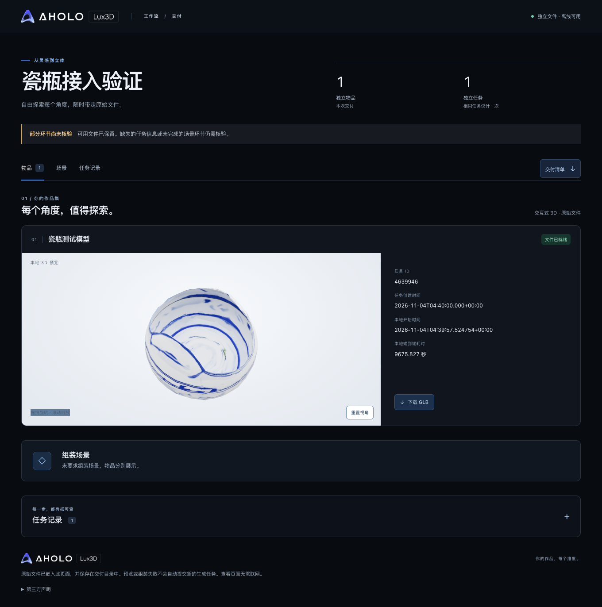

# T03 · Lux3D 接入验证结果

2026-11-04，接入技术验证完成，正式网站闭环待T06。产品成功口径仍为真实模型入包可预览；本轮入包证据来自明确隔离的验证用户/数据库，不冒充主应用功能验收。

## 真实调用与产物

用户明确批准一个预计1积分的瓷瓶验证批次；实际调用记录只有一个生成attempt，供方taskId **4639946**。报价额度承诺记1积分，未把账户余额或试用次数当作逐任务已结算金额。原报价、批准、预算和调用记录在私有Application Support/t03目录。

原图为仓库内自制512×512瓷瓶PNG（10,053字节），SVG源码也保留，不涉及第三方图片。使用极速版、目标50,000面、GLB、PBR开启、无四视图增强。供方返回成功，下载产物 **8,935,140字节、48,964三角面、1 mesh/1 material**。

GLB SHA-256：`15f22bbe7cf83f06b2cdf55e97ab0b87aeff947ddba0b13ea1372d2b253bd639`。有两张内嵌PNG纹理，无外部依赖。结构检查及真实Chrome离线渲染通过。**外形与输入瓷瓶有明显偏差，作为技术链路样本保留；不认定视觉复刻质量通过，也未追加生成。**

## 验证表

| 检查 | 实际结果 | 证据 |
|---|---|---|
| 私有中国区配置、账户鉴权 | PASS | raw鉴权的账户接口成功；key未进入项目/前端 |
| 旧插件账户查询报错定位 | 已解决于本轮调用 | Python3.9不接受服务端9位小数ISO时间；本轮仅进程内时间兼容处理取得有效报价，未修改插件 |
| 小文件上传 | PASS | 原图上传成功；Node适配器也实测，obsTaskId兼容 |
| 真正跨分片PNG上传 | PASS | 5,242,897字节，1次init、2个part，见evidence/T03-block-upload.json |
| 创建、查询和历史匹配 | PASS | 唯一供方ID4639946；查询status3，历史列表按该ID匹配 |
| 过期链接恢复 | PASS | 旧链接403过期→查询同任务获得新URL→下载，未重新生成 |
| GLB结构/摘要 | PASS | 头、版本、场景、材质与纹理，独立工具inspect和本地摘要一致 |
| 离线交互 | PASS | Chrome157.0.8103.38，禁止HTTP网络，旋转/缩放像素及interaction计数变化，reset有效，0页面错误 |
| 隔离验证入库 | PASS | 验证用户1、真实资产1、任务成功、原日reserve事件；模型与原图持久保存 |
| 入库回放/目标隔离 | PASS | 重放返回同资产；把应用DATABASE_URL改为不可达假目标仍只连接明确本机验证库 |
| 来源篡改负例 | PASS 4类 | 换任务ID、模型SHA、输入SHA、quoteId均拒绝；原回执恢复，见evidence/T03-negative-provenance.json |
| 离线协议/恢复单测 | PASS | create不重发、int64、未知码/409/429隔离、截止竞争、终态保护与上传差异 |
| 独立代码评审 | PASS | 初审来源绑定/隔离连接/失败分类与截止竞争已修复并复核 |

原任务已在等待期间完成；本地端到端时间包含会话中断和恢复，不作为模型生成延迟或性能指标。任务创建时间来自官方历史列表的created毫秒字段，不用本地时间倒推。

## 证据与文件位置

- `evidence/T03-live.json`：脱敏隔离资产、几何及回放结果。
- `evidence/T03-render.json` 与 `evidence/T03-model-preview.png`：实际离线交互与画面。
- `evidence/T03-block-upload.json`：真正分片上传结果。
- `~/Library/Application Support/aholo-lux3d/t03/artifacts/vase.glb`：原始模型。
- 同级 `delivery-v2/preview.html`、`delivery-v2/lux3d-delivery.json`：自包含离线模型预览和清单；assetStatus=complete、preview=generated。工具top-level status保留incomplete兼容值，不据此把已验证文件当成生成失败。
- 同级 `attempt.json`、`budget.json`、quote/upload/query/download-receipt：私有调用和临时链接证据，不能上传Git或附到用户页。
- 同级 `store/` 与独立PG验证库：真实验证资产持久数据。主应用库仍独立，用户账号/背包没有因此自动实现。

## 工程结论与剩余工作

中国区真实图片→生成→查询→临时产物→持久存储→渲染→隔离入库已经证明。安全transport及恢复判定可供T06集成；`generationReady` 仍为false，防止把探针当完整网站功能。

SDK原生int64风险、当前schema与OUS实测字段差异均已记入 [接入契约](../contracts/Lux3D接入契约.md)。真实跨日失败/返还、worker租约与事务集成、完整输入资源策略仍由T06/T09实测；本轮用离线故障与既有PG约束验证恢复原则，不制造额外付费失败任务。未知提交无可靠自动唯一匹配，只能保守隔离和对账，这不是声称供应商exactly-once。

下一步T04验证古建场景编辑、保存和性能；T06接入账号、正式资产与真实任务worker。当前无需新增云预算。
