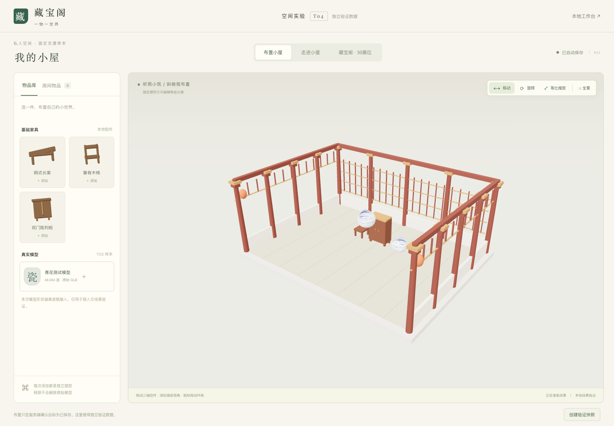
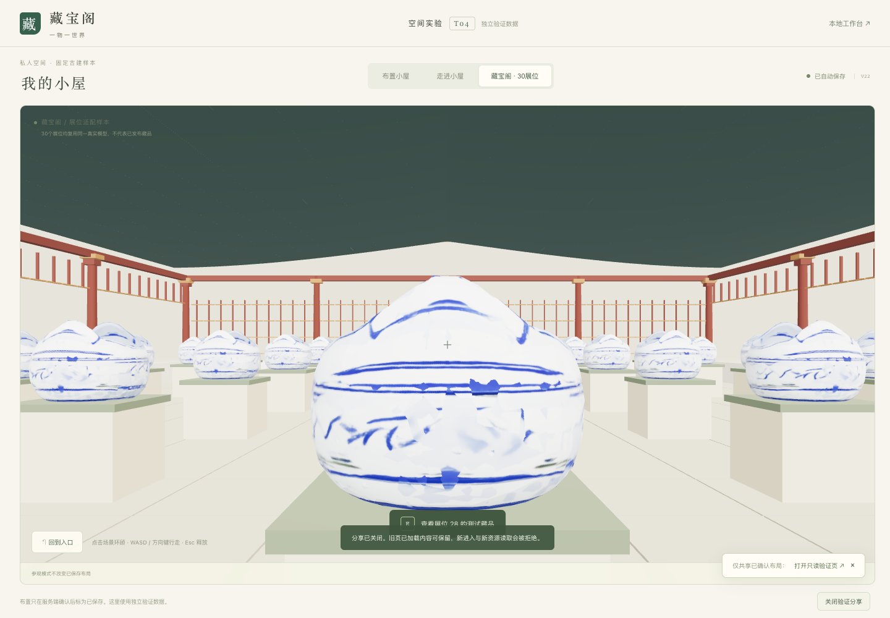

# T04 · 场景交互验证

2026-11-04。**场景技术样本通过；正式账号、PG保存/分享和策展仍由T06～T08接入。** 不把本轮实验服务当完整MVP验收，也不把古建样本当最终美术交付。

## 可操作产物与复现

运行 `npm run dev`，打开 [T04验证页](http://localhost:5173/lab/t04)。左侧添加家具或真实模型；选中后三轴移动/旋转、等比缩放；房间物品列表提供选择、定位、移除。切换走进小屋或30展位；场景点击环顾，WASD/方向键走动，E打开有效展位详情，Esc关闭详情或释放鼠标。

构建后运行：

```bash
npm run build
npm test
npm run test:t04
npm run test:t04:input
```

浏览器脚本在13004启动独立服务，随机临时状态目录，结束后删除；只读取T03原GLB，不写主业务库或用户自己的T04布局。基础PG集成/Chrome健康冒烟另有验证；运行健康冒烟前停止开发worker。

## 实际环境与素材

本机MacBook Pro / Apple M5 / 32GB / macOS26.6.2，Chrome 157.0.8103.38 无头模式；1440×1000视口，实测DPR1（应用上限1.5），ANGLE Metal Renderer Apple M5，非SwiftShader。编辑画布1114×774，展厅1382×774。记录见 `evidence/T04-device.json`。

真实模型任务4639946，原GLB8,935,140字节、48,964三角面、1mesh/1material，2张2048×2048内嵌PNG；源SHA与T03一致，见 `evidence/T04-model.json`。同源副本共享geometry/material/texture；家具和壳体为本地程序制作。本轮无新付费生成。

## 交互、恢复与授权验证

- 浏览器实际几何与共享bounds逐轴一致；共享纯数学500组随机XYZ旋转与独立参考一致。任意有效旋转/等比缩放边界检查通过，无效变换不保存。
- **真实鼠标**操作XYZ三轴移动、XYZ三轴旋转及等比缩放；物品拖动不改变相机。重复摆放ID独立；遮挡对象经列表定位/移除；移除其他副本不受影响。
- 重载恢复准确的已确认布局与变换。23项单元/API用例全通过；1500件布局服务端保存、重启恢复完整，无固定件数限制。
- 丢失成功响应按原key/body重放；在途新增编辑不被旧ACK标成已保存；ACK在用户暂停拖动时到达也不回弹。
- 确定422拒绝后修改可以重新提交；拒绝到达前已有新草稿会自动提交最新草稿。首次读取失败只重试GET，不PUT空默认布局。
- 双标签冲突保留草稿，显式载入服务器确认版；API实验会话失效自动重建一次并重送原key/body。
- 稳定分享入口刷新读最新确认版本，旧页保持已加载内容；关闭后阻止新进入/新资源，重开保持同一入口。保存失败期间仍能关闭既有分享。访客省略grant不能取得编辑端模型。
- 风险删除只清独立实验活动模型引用、拒绝新读；已加载旧页保留，家具保留，T03原文件不删除。
- 30展位数量、唯一slot编号与最长边1.15m适配1.2m台面实测；E只对中心射线最近有效命中目标，独立详情旋转缩放，详情打开时移动暂停。真实pointer lock、鼠标环顾、Esc释放及回入口通过。小屋分享无E详情。

细节证据：`evidence/T04-browser.json`、`evidence/T04-input.json`。故障为受控网络/回执注入，不声称供应商故障或真实公网环境；没有制造额外付费任务。

## 性能实测

每档加载完成暖机后采样3秒，所有布局记录保留；没有LOD降面、按件数截断或手工隐藏用户模型。自然视锥裁剪导致展厅当前可见三角面少于30件总和。表中记录实际渲染帧间隔，60FPS受当前显示/浏览器调度上限影响，不是GPU最高吞吐。

| 场景 | 摆放数 | 平均FPS | p95帧间隔 | 实际绘制三角面 | draw calls |
|---|---:|---:|---:|---:|---:|
| 小屋编辑 | 1 | 60.0 | 16.8ms | 52,878 | 9 |
| 小屋编辑 | 30 | 60.0 | 16.7ms | 1,472,834 | 38 |
| 小屋编辑 | 100 | 60.0 | 16.8ms | 4,900,314 | 108 |
| 小屋编辑 | 300 | 60.0 | 16.8ms | 14,693,114 | 308 |
| 展厅参观 | 30 | 60.0 | 16.8ms | 1,185,278 | 80 |

十个独立浏览器context各30件模型，同时编辑不同房间并重载核对完整30件：每页约60FPS，p95 16.7～16.8ms；保存确认535～636ms，**包含500ms自动保存防抖**。全部同一Mac上的无头上下文，不等于十台设备、真实网络或生产账号并发验收。证据包含每页帧数、视口、GPU、draw calls与保存时间。

建议T09回归基线为本机30件此复杂度模型时持续可操作、平均≥30FPS、p95帧间隔≤33.3ms；本轮短测高于该建议。DPR1.5/外接高分屏、不同高复杂度模型组合、长时间运行和生产事务负载仍需T09验证，不能将300样本视为产品件数上限或无限规模性能承诺。

## 资源生命周期

详情开关12次，另真实销毁/重建场景3次。每次独立renderer均停止循环、dispose并forceContextLoss，逐一验证context lost；主renderer geometry72、texture4前后相同。GC后JSHeapUsedSize 8,216,080→8,823,192字节，Nodes125→184、Documents1→1。有限次缓存/DOM差值明确保留，不宣称绝对零泄漏或精确VRAM字节。

## 当前结论与边界

E02的样本/坐标/边界已落可复用代码；E04与B01的保存/快照语义在独立实验服务验证通过；E06建立本机真实模型短测基线。正式用户权限、PG事务、删除竞争、真实候选策展、不同设备/网络与完整AC验收仍待T06～T09。实验服务只是单进程原子文件状态，不能用它替代生产多进程PG事务。

技术接入与视觉质量分开：T03模型外形偏差保留，此处用于技术验证。完整设计与来源见 [场景方案](../design/场景与交互方案.md)，跨模型复审见 [T04代码评审](../reviews/T04代码评审.md)。下一步T06正式账号/资产/生成闭环，再由T07复用本轮编辑与共享边界。




