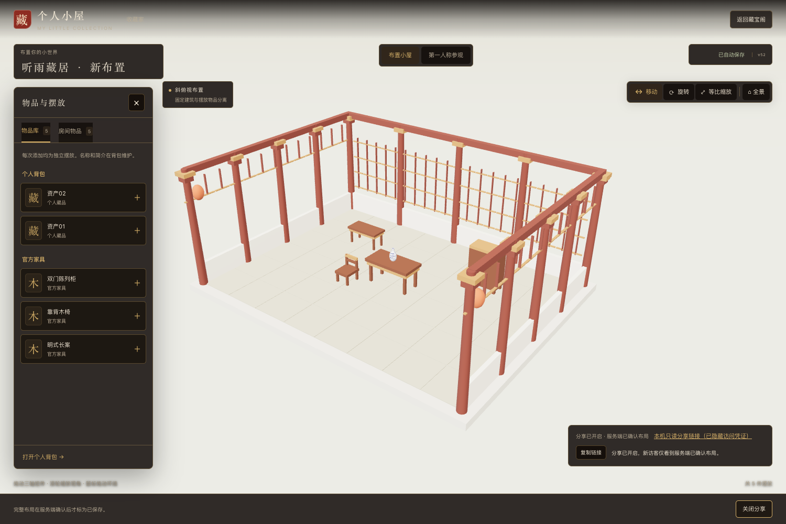
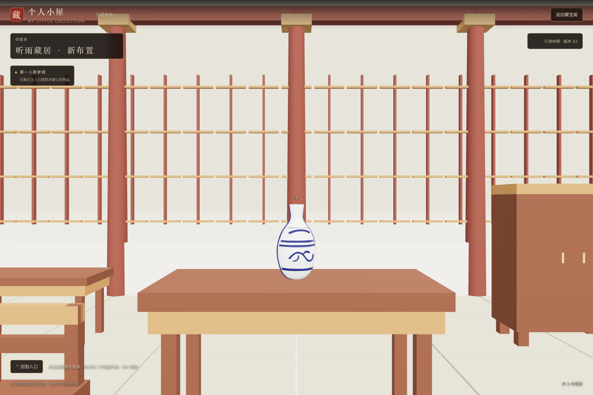

# T07 · 小屋保存与分享验证

日期：2026-11-05。范围 F05/F10、B01，覆盖 AC17～26 / AC39～42。正式服务复用 T06 账号与资产，不创建新的 Lux3D 任务。

## 已执行的工程检查

| 检查 | 结果与证据 |
|---|---|
| 全工作区构建 | PASS，`npm run build`，包含最终全视口HUD |
| 共享几何及既有单元回归 | PASS，`npm test` 67项，含保存状态机、真实资产UUID/bounds与5000件完整数组检查 |
| 保存异常状态机 | PASS，`tests/room-save.test.mjs` 6项，直接执行当前前端源代码，验证防抖/串行/丢响应/旧ACK/413/422/409/读取失败 |
| PostgreSQL集成回归 | PASS，5项；T07用随机独立数据库与临时私有store |
| 正式保存及授权 | PASS，`tests/t07-room.integration.mjs`：同键并发只一版、不同键同baseVersion仅一成功，历史版本不变、他人/非ready模型与越界拒绝 |
| 大布局 | PASS，12000件、超过1MiB正文完整保存/返回；超过64MiB明确413且不推进版本 |
| 稳定链接及快照 | PASS，密文/摘要绑定、旧版续期、当前昵称、cookie不能越grant、原图/未摆/他人模型拒绝，关闭重开epoch隔离与过期/删除撤销 |
| 官方家具 | PASS，桌/椅/柜均为真实GLB并实际Chrome加载渲染；重复seed无重复资产，系统来源记录不能登录 |
| 打包服务E2E | PASS，worker缺失/恢复、正式小屋登录门槛、无效分享拦截与工作台；`evidence/t07/service-smoke.png` |
| 独立模型评审 | PASS（gpt-6-astra），含全视口HUD最终复核，见 `../reviews/T07代码评审.md` |

故障与大布局测试使用隔离PG和明确标记的fixture，不把mock字节当成实际模型渲染证据；测试后删除随机数据库与临时store。

## 正式浏览器验证（PASS）

使用本机真实 Chrome 的两个独立 context，主人登录正式演示账号，访客不持会话。复用站内既有真实模型与新导入的3件官方家具，不调用生成接口、不删除背包资产。

入口 `scripts/t07-browser.mjs`，Chrome **157.0.8103.38**，1500×1000。9组真API检查全部通过，pageErrors=[]：

- 真实个人模型＋桌/椅/柜重复添加为6个独立摆放，真实鼠标完成XYZ移动、XYZ旋转及正等比缩放；编辑画布与访客画布均完整覆盖视口。
- 变换越界拒绝；保存确认后刷新，完整布置及变换一致。
- 截断的是已提交请求的网络响应：实际服务端已保存，原key/body重放后继续保存新草稿，未重复推进旧请求。
- 列表定位并移除一个副本，其他副本与原背包资产保留；当前所有个人资产ID和生成任务ID保持不变。
- 无登录访客仅加载已摆放模型；原图、未摆背包及整个资产目录访问拒绝。
- 主人普通保存后旧页面保持旧版，续期不换版；关闭分享后旧画面保留，新进入/新文件拒绝。重开仍是原链接，旧grant不复活。
- 第一人称真实指针锁定行走、回到入口通过；分享页无编辑工具、背包、E详情或下载入口。

演示小屋保留5件陈列（2张长案、1把木椅、1个柜、1个已有瓷瓶），已确认版52；未替换/删除其他背包模型。分享访问凭证只保存在私有 `Application Support/aholo-lux3d/t07/share-url.txt`，公开截图已隐藏凭证文字。

证据：`evidence/t07/browser.json`、`owner-editor.png`、`anonymous-visit.png`。隔离UI回归 `apps/web/scripts/t07-ui-check.mjs` 另16项通过，覆盖全视口、抽屉、真实拖动遇旧ACK不回弹、共享资源/归一化、保存异常、续期原key与强scope；原T06 UI 11项回归通过。该隔离UI脚本拦截API，不充当本节的真实API证据。

## 范围边界

没有新增云部署、共享编辑、布局实时同步、手动保存、撤销重做、模型下载或付费生成。分享响应只含其快照的必要模型引用与变换，不返回全背包或私有文字；T08完整风险删除仍另行实现。
