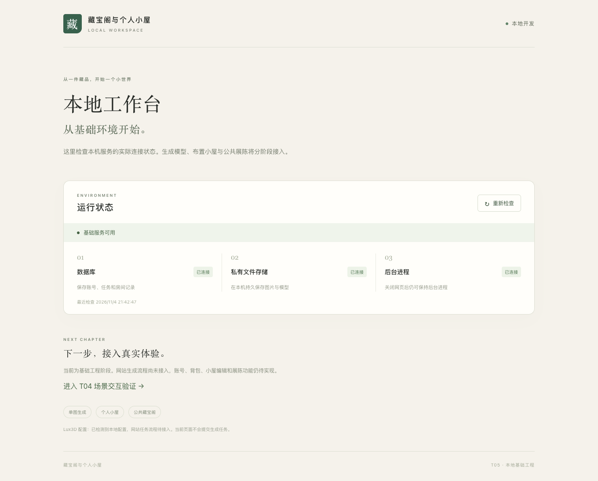

# T05 本地基础工程验证

日期：2026-11-04；状态：完成。范围为基础工程，不是业务验收。运行说明见 [本地运行](../本地运行.md)。

## 实际环境

macOS26.6.2/arm64，Node24.16.0、npm11.13.0；PostgreSQL18.6（Postgres.app2.9.6）；真实 Chrome157.0.8103.38。依赖精确版本及完整树见根package-lock.json；TypeScript7.0.2、Vite8.3.5、React19.3.1、Fastify5.12.8、pg8.23.1。

Postgres.app官方DMG已验证挂载并复制到用户 Applications；本项目使用私有集群及55432端口，无全局PATH修改。Git本地main仓库已初始化，尚未提交；.env与node_modules/dist均忽略。

## 结果

| 检查 | 结果 | 实际证据 |
|---|---|---|
| npm ci --ignore-scripts --dry-run | PASS | 锁文件与工作区一致 |
| npm run build | PASS | contracts/domain/api/worker编译，web生产构建 |
| npm test | PASS 6/6 | 存储持久化/越界/根替换/提交重试4项，真实孙进程延迟/忽略TERM退出2项 |
| npm run test:integration | PASS 1个集成场景 | 真实PG迁移2次幂等、失败迁移回滚、单用户在途唯一、扣次事件唯一、事务回滚、管理员种子重跑不改密/不提升普通用户、二进制文件备份与隔离恢复、损坏备份拒绝 |
| npm run test:e2e | PASS | live200，缺worker ready503，worker连接后ready200；generationReady=false；API/编码API/缺失静态文件不返回伪HTML；Chrome页面无JS错误 |
| npm audit --audit-level=moderate | PASS | 当前锁文件0个已知漏洞；不是永久保证 |
| local:setup重复、db:stop/start后迁移 | PASS | 密码及配置保留；迁移2条、展位30条 |
| 本机业务库备份与restore:check | PASS | 原库users0/assets0，dump恢复行数及文件集合一致；空库filesVerified0；随机恢复库清理 |
| npm run dev实际入口/代理 | PASS | localhost:5173与127.0.0.1:3001的ready均200；数据库/存储/worker均ok |
| 实际Ctrl+C | PASS | 管理器正常退出；进程组清理另有两项回归测试 |

## 修复和独立复核

初次构建修复CSS类型声明，管理员scrypt使用明确的异步类型；noEmitOnError防止失败后输出新构建。静态服务依赖升级至@fastify/static10.1.8，并将glob14.0.3/minimatch11.0.4定向锁定以清除已知问题；该override跨上游声明major，已通过生产静态服务、API与缺失文件冒烟，后续升级须重新验证。

独立模型gpt-6-astra初审FAIL：根目录替换、probe误报、commit重试、孙进程残留。已修复并增加定向测试，复审PASS，无剩余T05代码阻断；详细见 [T05代码评审](../reviews/T05代码评审.md)。

尚未执行：账号登录界面、真实Lux3D、背包/编辑/投稿/展陈/调额/删除业务和10会话性能验收。没有创建伪造业务成功或默认管理员；T03/T04/T06～T09继续完成。
