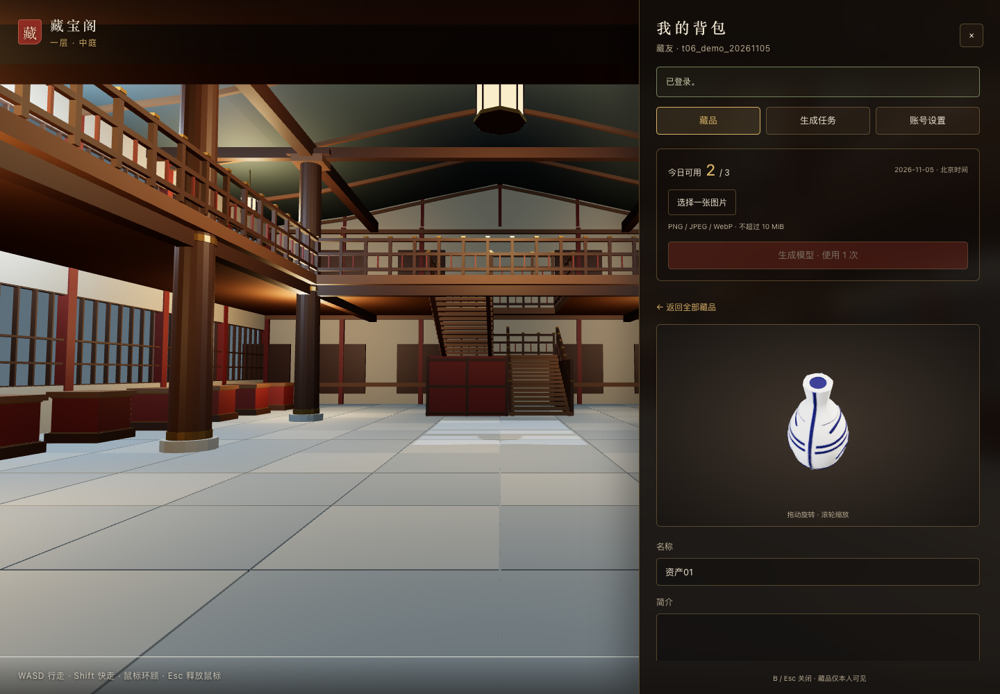

# T06 · 账号、资产与生成验证

日期：2026-11-05。正式接口已接入首页藏宝阁背包抽屉；本轮不包含 T07 小屋保存/分享或 T08 完整投稿策展后台。

## 范围与实现

- F01：普通注册、固定登录账号、昵称修改、原密码校验后改密；七天 HttpOnly / SameSite Strict 会话，改密撤销全部会话，持久登录限流及 Origin/CSRF 校验。
- F02/F03：单图上传；北京时间默认每日 3 次、单用户在途 1 个；同键并发先取请求锁、再校验回执和业务状态；task/attempt/job/reserve/额度/回执原子受理。失败只冲销原提交日一次。
- F04：首页 B 背包抽屉内注册登录、额度、图片生成、任务、背包分页、模型旋转缩放、名称简介与账号设置。关闭网页不影响持久任务；生成丢响应保留原请求键/正文，刷新后可确认原请求。
- 管理员导入基础：仅 GLB、家具或官方候选；异步验证后一次性发布资产/候选/占用，重放不重复发布。完整管理后台 UI 留 T08。

代码入口：`apps/api/src/business.ts`、`packages/domain/src/accounts.ts` / `requests.ts` / `generation.ts` / `resources.ts`；迁移 `003_generation_delivery.sql`；前台 `apps/web/src/game/Backpack.tsx`。

## 已执行检查

| 检查 | 结果与证据 |
|---|---|
| 全工作区构建 | PASS，`npm run build` |
| 单元/资源/导航回归 | PASS，59项（含报价source=1与真实Chrome渲染） |
| 真实 PG/API 集成 | PASS，`tests/t06-api.integration.mjs`：注册/上传/生成同键并发、房间原子、额度、CSRF、越权、改密、文件与导入受理 |
| worker 隔离 PG | PASS，`tests/t06-worker.integration.mjs`：成功唯一入包、重放、原日退款、未知提交不重发、精确 nonce/大整数 ID 证据、失租 fence、终态保护、导入家具/官方候选、文件篡改拒绝 |
| 模型输入资源策略 | PASS，PNG/JPEG/WebP 真解码、损坏图拒绝；GLB 外链/超大 accessor/越界 view/节点环/实例放大/morph/扩展拒绝；合法 GLB 真 Chrome 渲染 |
| 首页 UI 回归 | PASS，`apps/web/scripts/t06-ui-check.mjs`：11 项；拦截 API，不冒充真实生成证据 |
| 大于30件背包及任务 | PASS，`apps/web/scripts/t06-pagination-check.mjs`：60/65件、31/61件详情、未加载资产按ID打开、轮询保留分页、工作台真实状态；拦截 API |
| 藏宝阁实走回归 | PASS，`npm run test:t10`：55秒键盘上下楼往返、2774处GLB对照0偏差、输入互斥；`evidence/t06/t10-regression.json` |
| 基础服务E2E | PASS，`npm run test:e2e`：worker缺失503、恢复200、禁用新生成状态与API路由/工作台；`evidence/t06/service-smoke.png` |
| 独立模型评审 | PASS，`docs/reviews/T06代码评审.md`；产出 Codex，独立评审 gpt-6-astra |

单元与 PG 故障测试不调用真实供方、不写用户原库，随机测试库与临时 store 均在结束时删除。未知提交故障使用 mock，未制造额外付费失败任务。

## 真实生成验收（PASS）

用户在本会话明确批准一次 1 积分批次：瓷瓶 PNG，极速版、目标 50,000 面、GLB、PBR 开启、尺寸预测关闭、不开四视图。正式演示账号 `t06_demo_20261105` 由注册 API 创建；密码仅保存在私有 Application Support/t06/site-account.json，不进入 Git/证据截图。

- 本站 task：`671b3671-173a-458b-b6f8-e657b935388c`。
- 供方 task：`4701141`。
- 报价承诺：1 积分，已记录至 provider_attempts；不把报价承诺说成逐单实际结算。
- 站内额度：受理当日已用1次、剩余2次。
- 已完成：本站 succeeded，资产 `f4c2533c-2fa8-49b3-8a6f-6a98b7860ab5`，默认名“资产01”；模型 9,030,232 字节、48,204 三角面，实际渲染与首页旋转/缩放通过。
- 模型 SHA-256：`8bfa56e8b1191dfaa0b2f33a5a50f5487afc4b2d5f406fef127b92d753c799f3`；reserve=1、refund=0；仅一个 provider_attempt，费用承诺1积分。
- Chrome 157.0.8103.38：首页真实API登录→背包→预览→关闭重开→刷新保持会话→任务成功，pageErrors=[]，旋转/缩放像素变化均通过。
- 证据：`evidence/t06/real-delivery.json`、`evidence/t06/browser.json`、`evidence/t06/backpack-real-model.png`、`evidence/t06/task-succeeded.png`。

`node scripts/t06-live.mjs status` 读取正式账号结果；`submit` 仅在私有批次授权记录存在时受理/恢复同一 task，重跑不换请求键。常驻 worker 自动处理队列；从未按时间相近的历史任务认领原任务。

## 恢复与工程限制

create 前先持久化 dispatch_started、精确参数、报价 ID 和承诺；网络副作用在共享维护锁内，返回 ID 绑定 dispatch_nonce 保存，即使恢复时也不重新 create。未知提交保持供方占用；24小时交付截止仅终结本站任务并原日返还，不假定供方取消/退款。已失败任务的迟到结果不复活。

模型验证使用本机 Chrome 的 GLTFLoader/WebGL；仅成功下载、供方 status3 或头部检查不能发布 ready。先校验静态自包含 GLB 的解码/纹理/节点预算，再真正加载渲染，回执绑定 attempt/provider ID/原图SHA/请求SHA/输出槽/模型SHA，发布事务再核验落存摘要和 fence。

文件为私有 no-store，每次请求重新校验当前会话与本人/家具/管理关系。分享 grant 留 T07；风险删除完整引用清理留 T08；本轮未宣称全部 AC01～AC51 验收完成。
